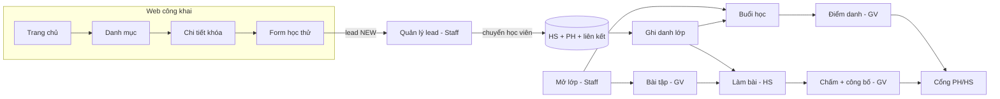

# 02 — Software Requirements Specification (SRS)

## Document control

| Mục | Giá trị |
|---|---|
| Hệ thống | CoreLink Academy v3 |
| Phiên bản / trạng thái | 1.0 / Baselined (2026-10-21) |
| Owner | Trợ lý (Requirements Engineer) · Phê duyệt: chủ dự án |
| Reviewer | Architect/BE (khả thi), QA (kiểm thử được) — trợ lý kiêm, chưa có reviewer độc lập |
| Nguồn chuẩn phạm vi | [01-requirements.md](01-requirements.md). SRS này diễn giải chi tiết, không thêm FR mới |
| Lịch sử | 1.0 — tạo mới phiên 3 từ 01 + đối chiếu code |

## 1. Purpose and scope

- **Mục đích:** mô tả hành vi quan sát được của từng FR đủ để developer hiện thực và QA viết test.
- **Ranh giới sản phẩm:** một ứng dụng web Next.js (công khai + nội bộ), một database MySQL. Không có API công khai, không có tích hợp bên ngoài ở Pha 1.
- **Nền tảng:** trình duyệt hiện đại (Chrome, Edge, Safari, Firefox 2 phiên bản gần nhất) trên điện thoại ≥ 360px và máy tính. Không hỗ trợ IE.
- **Non-goals:** xem [00 §4 Out of scope](00-project-brief.md#out-of-scope-pha-1).

## 2. Stakeholders, actors and environment

| Actor | Giả định kỹ thuật | Thiết bị chính |
|---|---|---|
| Khách (phụ huynh 30–50 tuổi) | Kỹ năng điện thoại cơ bản, mạng 4G | Điện thoại |
| Staff | Dùng máy tính văn phòng cả ngày | Máy tính, đôi khi điện thoại |
| Admin | Như Staff | Máy tính |
| Giáo viên | Điểm danh giữa giờ, chấm bài tối | Điện thoại (điểm danh), máy tính (soạn/chấm) |
| Học sinh (lớp 1–12) | HS nhỏ có thể dùng tài khoản do phụ huynh giữ | Điện thoại/máy tính bảng |
| Phụ huynh | Như Khách | Điện thoại |

Môi trường triển khai: dev Windows + MySQL 8 local; production **TBD** (QUESTION-Q04). Tất cả thời gian nghiệp vụ theo giờ Việt Nam (UTC+7, không có giờ mùa hè).

## 3. Terminology and references

Thuật ngữ: [01 §1](01-requirements.md#1-thuật-ngữ). Tài liệu nguồn: 03 (quyền), 06 (BR, trạng thái), 08 (màn hình, thông điệp), 10 (dữ liệu), 11 (Server Action + mã lỗi).

Quy ước trong mục 5: **Pre** = tiền điều kiện, **Trig** = kích hoạt, **Beh** = hành vi chính, **Val** = validate, **Perm** = quyền (kiểm tra server), **Err** = lỗi/nhánh phụ, **AC** = tiêu chí chấp nhận, **Trace** = UC / màn hình / action-query / bảng / test.

## 4. Product overview

Phụ thuộc: MySQL 8 sẵn sàng; font Google (Be Vietnam Pro, Lora) tải lúc build (`next/font`).

## 5. Functional requirements

### 5.1 Công khai và tuyển sinh

#### FR-001 — Trang chủ
- **Rationale:** điểm vào cho phụ huynh, dẫn tới học thử (GOAL-001).
- **Actor:** Khách (cũng truy cập được khi đã đăng nhập).
- **Beh:** hiển thị (1) giới thiệu ngắn + nút "Đăng ký học thử", "Xem khóa học"; (2) "Các môn đang giảng dạy": môn có ≥ 1 khóa đã xuất bản, sắp theo `sortOrder`, kèm số khóa, liên kết `/khoa-hoc?mon=<slug>`; (3) "Khóa học nổi bật": tối đa 3 khóa `isPublished && isFeatured`, mới cập nhật trước; (4) "Bắt đầu như thế nào" 3 bước + nút học thử.
- **Err:** không có môn/khóa → ẩn khối tương ứng (không hiển thị khối rỗng). Lỗi DB → trang lỗi chung.
- **AC:**
  - Given khóa A xuất bản + nổi bật, khóa B nổi bật nhưng chưa xuất bản, When mở `/`, Then thấy A, không thấy B.
  - Given môn Hóa chỉ có khóa chưa xuất bản, Then môn Hóa không xuất hiện.
- **Trace:** UC-013 · SCREEN-001 · Q-001, Q-002 · subjects, courses · TC-UAT-02.

#### FR-002 — Danh mục khóa học
- **Beh:** form GET `mon` (slug), `khoi` (1..12). Danh sách thẻ khóa: tên, môn, khối, trình độ, số buổi × phút, học phí tham khảo hoặc "Liên hệ". Hiện số lượng kết quả (`aria-live`). Nút "Bỏ lọc" khi đang lọc.
- **Val:** `mon` phải khớp `^[a-z0-9-]{1,80}$`; `khoi` nguyên 1..12; sai → bỏ qua tham số đó (không lỗi).
- **Err:** không có kết quả → EmptyState "Chưa có khóa học phù hợp với lựa chọn này." + nút "Để lại thông tin để được tư vấn".
- **AC:** Given khóa Tiếng Anh THCS lớp 6–9, When `?mon=tieng-anh&khoi=7`, Then có khóa đó; When `?khoi=10`, Then không có. When `?khoi=abc`, Then hiển thị như không lọc khối.
- **Trace:** UC-013 · SCREEN-002 · Q-003 · courses · `public.test.ts`.

#### FR-003 — Chi tiết khóa học
- **Beh:** breadcrumb Khóa học / Môn; tiêu đề; mô tả; nút "Đăng ký học thử khóa này" → `/dang-ky-hoc-thu?khoa=<slug>`; khối thông tin (đối tượng, trình độ, số buổi × phút, học phí tham khảo/"Liên hệ") + chú thích "Học phí chỉ để tham khảo"; Mục tiêu (danh sách); Lộ trình (đánh số); Lớp đang tuyển: lớp `OPEN` sắp theo ngày khai giảng, lịch (thứ + giờ), khai giảng, "Còn N chỗ"/"Đã đủ học sinh" (N = capacity − ACTIVE − PAUSED).
- **Err:** slug không tồn tại hoặc khóa chưa xuất bản → 404; không có lớp OPEN → "Hiện chưa có lớp mở…".
- **AC:** Given khóa "Thuật toán nâng cao" chưa xuất bản, When mở `/khoa-hoc/tin-hoc-thuat-toan-nang-cao`, Then 404.
- **Trace:** UC-013 · SCREEN-003 · Q-004 · courses, classes, enrollments · TC-UAT-02.

#### FR-004 — Form học thử
- **Pre:** có ít nhất một môn.
- **Trig:** Khách gửi form `/dang-ky-hoc-thu`.
- **Beh:** (1) honeypot → FR-005; (2) rate limit → FR-005; (3) validate; (4) chuẩn hóa SĐT; (5) trong một transaction: tìm lead đang mở cùng SĐT (mới nhất) → nếu có: thêm hoạt động `RESUBMITTED` (nội dung đầy đủ form), cập nhật `updatedAt`; nếu không: tạo lead `NEW`, nguồn `web_form`, + hoạt động `CREATED` ghi "Đồng ý liên hệ lúc HH:mm dd/MM/yyyy"; (6) chuyển `/dang-ky-hoc-thu/cam-on`.
- **Val:** `parentName` 2–120; `phone` bắt buộc, ≤ 20, chuẩn hóa được (BR-001); `email` tùy chọn, ≤ 191, định dạng email, viết thường; `studentName` 2–120; `gradeLevel` 1..12; `subjectId` tồn tại; `courseSlug` tùy chọn — nếu không phải khóa đã xuất bản thì bỏ qua; `note` ≤ 1000; `consent` bắt buộc.
- **Perm:** không cần đăng nhập.
- **Err:** lỗi validate → "Vui lòng kiểm tra lại các ô được đánh dấu." + lỗi từng ô, giữ giá trị đã nhập; môn không tồn tại → lỗi ô môn (`INVALID_SUBJECT`).
- **AC:**
  - Given không có lead nào SĐT `+84912345678`, When gửi với `0912 345 678`, Then có lead NEW với phone `+84912345678` và 1 hoạt động CREATED.
  - Given lead CONTACTED cùng SĐT, When gửi lại, Then không tạo lead mới, lead cũ có thêm RESUBMITTED.
  - Given lead LOST cùng SĐT, When gửi, Then tạo lead NEW mới.
  - When bỏ tích đồng ý, Then lỗi "Bạn cần đồng ý để học viện liên hệ tư vấn." và không lưu.
- **Trace:** UC-001 · SCREEN-004, 005 · API-001 · leads, lead_activities · TC-001, TC-002, TC-003.

#### FR-005 — Chống spam
- **Beh:** ô ẩn `website` có giá trị → chuyển trang cảm ơn, không lưu, không đếm rate limit. Mỗi lần gửi hợp lệ về hình thức tăng bucket `trial:<ip>`; lần thứ 6 trong cửa sổ 10 phút cố định → từ chối.
- **Err:** "Bạn đã gửi quá nhiều lần trong thời gian ngắn. Vui lòng thử lại sau 10 phút." (giữ giá trị đã nhập).
- **Lưu ý:** IP lấy từ `X-Forwarded-For` (phần tử đầu) hoặc `X-Real-IP`; sau reverse proxy phải cấu hình proxy ghi đè header (RISK-009).
- **Trace:** UC-001 · API-001 · rate_limit_buckets · TC-004.

#### FR-006 — Danh sách lead và nhập lead thủ công
- **Actor:** Staff, Admin.
- **Beh (danh sách):** lọc `status`, `mon` (subjectId), `q` (tên phụ huynh/học sinh hoặc SĐT; nếu `q` chuẩn hóa được thành SĐT → so khớp chính xác), `quahan=1` (NEW quá 24h). Sắp `createdAt` giảm dần, 20/trang. Cột: phụ huynh/học sinh, SĐT (định dạng `0912 345 678`), quan tâm (khóa hoặc môn), trạng thái + nhãn "Quá hạn", ngày tạo.
- **Beh (nhập tay — API-021):** form: họ tên phụ huynh, SĐT, email, họ tên học sinh, khối (tùy chọn), môn (tùy chọn), khóa (tùy chọn), nguồn (`phone` Gọi điện · `walk_in` Đến trực tiếp · `referral` Được giới thiệu · `other` Khác), ghi chú. Tạo lead NEW + hoạt động CREATED có `actorId` = người nhập. Chuyển tới chi tiết lead mới.
- **Val (nhập tay):** như FR-004 trừ: không có `consent` (Staff xác nhận đã hỏi ý — ghi trong hoạt động), `gradeLevel` và `subjectId` tùy chọn, `source` thuộc 4 giá trị trên.
- **Err:** trùng SĐT với lead đang mở → `DUPLICATE_OPEN_LEAD` "SĐT này đang có lead chưa xử lý xong." + liên kết tới lead đó, không tạo (BR-011).
- **AC:** Given lead NEW tạo 25 giờ trước, When mở `/quan-ly/lead?quahan=1`, Then lead đó có nhãn "Quá hạn". Given Staff nhập tay SĐT mới, Then lead NEW nguồn "Gọi điện" xuất hiện đầu danh sách.
- **Trace:** UC-002, UC-020 · SCREEN-009, 011 · Q-005, API-021 · leads, lead_activities · TC-005, TC-039, TC-040, TC-045.

#### FR-007 — Đổi trạng thái lead
- **Beh:** chỉ hiển thị các trạng thái kế tiếp hợp lệ (BR-010). Trong transaction: đọc trạng thái hiện tại → kiểm tra chuyển → `updateMany where status = cũ` → ghi hoạt động `STATUS_CHANGE` "CŨ → MỚI[. Lý do: …]". Chuyển sang LOST lưu `lostReason`; chuyển khỏi LOST (mở lại → CONTACTED) xóa `lostReason`.
- **Err:** `INVALID_TRANSITION`, `LOST_REASON_REQUIRED` (lỗi ô lý do), `STALE` (người khác vừa đổi), lead không tồn tại → 404.
- **Trace:** UC-002 · SCREEN-010 · API-002 · leads, lead_activities · TC-005, TC-006.

#### FR-008 — Ghi chú lead
- **Beh:** ghi chú 1–2000 ký tự → hoạt động `NOTE` có người thực hiện; cập nhật `updatedAt` lead. Lịch sử hiển thị: loại · thời điểm · người (hoặc "Hệ thống") · nội dung (giữ xuống dòng).
- **Trace:** UC-002 · SCREEN-010 · API-003 · lead_activities.

#### FR-009 — Chuyển lead thành học viên
- **Pre:** lead ∈ {NEW, CONTACTED, TRIAL_SCHEDULED, TRIAL_DONE}.
- **Beh:** form điền sẵn từ lead (tên HS, khối, tên PH, SĐT, email PH); thêm email/SĐT học sinh (tùy chọn), lớp (tùy chọn — danh sách lớp OPEN/IN_PROGRESS còn chỗ). Băm sẵn 2 mật khẩu tạm ngoài transaction. Transaction (thử lại tối đa 3 lần nếu va chạm mã HS):
  1. Khóa lead, kiểm tra trạng thái.
  2. Phụ huynh: tìm user theo SĐT phụ huynh → nếu có và là PARENT: dùng lại (không cấp mật khẩu); nếu có nhưng vai trò khác → lỗi; nếu không: kiểm tra email trùng, tạo PARENT `mustChangePassword = true`.
  3. Kiểm tra SĐT/email học sinh chưa dùng; tạo STUDENT với mã `HSyyNNNN`, `mustChangePassword = true`.
  4. Tạo guardianship.
  5. Nếu chọn lớp: ghi danh theo FR-019 (khóa dòng lớp).
  6. Lead → ENROLLED, `convertedStudentId`; hoạt động `CONVERTED`; audit `lead.convert` {from, studentId, parentId, parentReused, classId}.
- **Kết quả:** thông báo thành công + mã HS + thẻ "Mật khẩu tạm — chỉ hiển thị một lần" cho tài khoản mới tạo có thông tin đăng nhập. Học sinh không có email/SĐT → tài khoản tạo nhưng chưa đăng nhập được, kèm ghi chú (DECISION-D12).
- **Val:** SĐT HS ≠ SĐT PH; email HS ≠ email PH; các trường như FR-004.
- **Err:** `INVALID_TRANSITION`, `PHONE_TAKEN_BY_OTHER_ROLE`, `DUPLICATE_EMAIL`, `DUPLICATE_PHONE`, `CLASS_FULL`, `ALREADY_ENROLLED`, `SCHEDULE_CONFLICT`, `CLASS_CLOSED` — mọi lỗi: không bản ghi nào được lưu.
- **AC:** Given lớp đầy, When chuyển lead chọn lớp đó, Then lỗi "Lớp đã đủ sĩ số." và DB không có user mới, lead vẫn trạng thái cũ.
- **Trace:** UC-003 · SCREEN-010 · API-004 · users, guardianships, enrollments, leads, lead_activities, audit_logs · TC-007, TC-008.

### 5.2 Tài khoản và phân quyền

#### FR-010 — Đăng nhập / đăng xuất
- **Beh:** `identifier` có `@` → email (viết thường); còn lại → chuẩn hóa SĐT. Không tìm thấy → vẫn chạy một phép băm giả (chống dò tài khoản qua thời gian phản hồi) rồi báo lỗi chung. Đúng mật khẩu + ACTIVE → reset bộ đếm, tạo phiên: token 32 byte ngẫu nhiên trong cookie `cl_session` (httpOnly, SameSite=Lax, Secure ở production, 7 ngày), DB lưu sha256(token). Chuyển `/doi-mat-khau` nếu `mustChangePassword`, ngược lại tổng quan theo vai trò (ADMIN/STAFF `/quan-ly`, TEACHER `/giao-vien`, STUDENT `/hoc-sinh`, PARENT `/phu-huynh`). Đã đăng nhập mà mở `/dang-nhap` → chuyển như trên. Đăng xuất: xóa bản ghi phiên + cookie → `/dang-nhap`.
- **Err:** "Thông tin đăng nhập không đúng." (không phân biệt sai email hay sai mật khẩu); tài khoản DISABLED (đúng mật khẩu) → "Tài khoản đã bị khóa. Vui lòng liên hệ học viện."; giữ lại ô email/SĐT khi lỗi.
- **Trace:** UC-004 · SCREEN-006 · API-005, API-006 · users, sessions · TC-009, TC-046.

#### FR-011 — Khóa tạm
- **Beh:** mỗi lần sai mật khẩu tăng `failedLoginCount`; lần thứ 5 → `lockedUntil = now + 15 phút`, đặt lại bộ đếm. Trong thời gian khóa: từ chối trước khi kiểm tra mật khẩu. Ngoài ra mỗi lần gửi form đăng nhập tăng bucket `login:<ip>`; lần 21 trong 10 phút → "Quá nhiều lần đăng nhập từ thiết bị này. Vui lòng thử lại sau 10 phút." (BR-009).
- **Err:** "Bạn đã nhập sai 5 lần. Tài khoản tạm khóa 15 phút." · "Tài khoản tạm khóa do đăng nhập sai nhiều lần. Vui lòng thử lại sau 15 phút."
- **Trace:** UC-004 · API-005 · users, rate_limit_buckets · TC-010, TC-043.

#### FR-012 — Đổi mật khẩu
- **Beh:** form mật khẩu hiện tại, mới, nhập lại. Thành công → băm mới, `mustChangePassword = false`, thu hồi các phiên khác (giữ phiên hiện tại), chuyển tổng quan kèm thông báo "Đã đổi mật khẩu.". Khi `mustChangePassword = true`: mọi trang/action nội bộ (qua `requireActor`) chuyển về `/doi-mat-khau`; trang này hiện Alert "Bạn đang dùng mật khẩu tạm…" và không có liên kết quay lại.
- **Val:** mới đạt BR-006; nhập lại khớp; mới ≠ hiện tại.
- **Err:** "Mật khẩu hiện tại không đúng." (lỗi ô).
- **Trace:** UC-004 · SCREEN-007 · API-007 · users, sessions · TC-011, TC-012.

#### FR-013 — Quản trị người dùng
- **Actor:** Admin (toàn bộ); Staff chỉ **tạo** STUDENT/PARENT ở `/quan-ly/hoc-vien`.
- **Beh:** danh sách lọc vai trò, trạng thái, tìm tên/email/SĐT/mã HS, 25/trang, nhãn "Tạm khóa do sai mật khẩu" khi `lockedUntil > now`. Tạo: vai trò, họ tên, email/SĐT (ít nhất một), khối (bắt buộc với HS) → mật khẩu tạm hiện một lần, `mustChangePassword = true`, HS có mã tự sinh, audit `user.create`. Sửa: họ tên, vai trò, email, SĐT, khối; đổi vai trò → audit `user.role_change` + thu hồi phiên; đổi sang STUDENT chưa có mã → sinh mã. Khóa → `DISABLED`, thu hồi phiên, audit `user.disable`; mở khóa → `ACTIVE`, xóa khóa tạm, audit `user.enable`. Đặt lại mật khẩu → mật khẩu tạm mới, `mustChangePassword`, xóa khóa tạm, thu hồi phiên, audit `user.reset_password`.
- **Err:** `NO_LOGIN`, `DUPLICATE_EMAIL`, `DUPLICATE_PHONE`, `CANNOT_MODIFY_SELF` (tự đổi vai trò/tự khóa); Staff tạo vai trò khác HS/PH → 404.
- **Trace:** UC-012 · SCREEN-016, 017, 018 · API-008 · users, sessions, audit_logs · TC-036, TC-038.

#### FR-014 — Liên kết phụ huynh–học sinh
- **Beh:** tại `/quan-ly/hoc-vien` mỗi học sinh hiện phụ huynh đã liên kết (n/4), nút "Bỏ" (xác nhận), chọn phụ huynh để liên kết (chỉ PH đang hoạt động, chưa liên kết với HS này). Liên kết trong transaction có khóa dòng học sinh để đếm chính xác.
- **Err:** `ALREADY_LINKED`, `MAX_GUARDIANS`, phụ huynh không hợp lệ (`INVALID`).
- **Trace:** UC-012 · SCREEN-016, 018 · API-009 · guardianships · TC-037.

### 5.3 Đào tạo

#### FR-015 — Môn và khóa học
- **Beh (môn):** danh sách môn (tên · số khóa) với form sửa tại chỗ; thêm môn (tên 2–80, slug, thứ tự 0–999, mô tả ≤ 2000); **xóa môn** khi chưa có khóa (lead tham chiếu → bỏ tham chiếu).
- **Beh (khóa):** danh sách (tên, môn, khối, số lớp đã mở, Đã xuất bản/Ẩn, Nổi bật); tạo/sửa đầy đủ trường; mục tiêu mỗi dòng một ý; lộ trình mỗi dòng "Tiêu đề | chi tiết"; xóa khi chưa có lớp (lead tham chiếu → bỏ tham chiếu). Mọi thay đổi làm mới trang công khai.
- **Val:** slug `^[a-z0-9]+(-[a-z0-9]+)*$` 2–160 (môn ≤ 80); `gradeFrom ≤ gradeTo`; số buổi 1–500; phút/buổi 15–300; học phí trống hoặc nguyên 0–1.000.000.000 (chấp nhận dấu chấm/phẩy/khoảng trắng).
- **Err:** `DUPLICATE_SLUG`, `HAS_CLASSES`, `HAS_COURSES`.
- **Trace:** UC-014 · SCREEN-019, 020, 021 · API-010, API-022 · subjects, courses · TC-041.

#### FR-016 — Phòng học
- **Beh:** danh sách phòng (thẻ) sửa tại chỗ; thêm (tên 1–60, sức chứa 1–500); xóa khi không có lớp/buổi tham chiếu.
- **Err:** `DUPLICATE_NAME`, `IN_USE`.
- **Trace:** UC-014 · SCREEN-022 · API-010 · rooms.

#### FR-017 — Mở lớp
- **Beh:** form: khóa (hiện số buổi mẫu), mã lớp (tự viết hoa, `[A-Z0-9._-]` 2–30), giáo viên (TEACHER ACTIVE), phòng (tùy chọn, hiện sức chứa), ngày bắt đầu (mặc định hôm nay giờ VN), thứ trong tuần (≥ 1), giờ bắt đầu/kết thúc (mặc định 18:00–19:30), số buổi 1–200, sĩ số 1–100 (mặc định 16). Sinh buổi theo BR-023, kiểm tra trùng (FR-018), transaction tạo lớp `OPEN` + buổi `SCHEDULED` (giáo viên/phòng của buổi = của lớp) → chuyển chi tiết lớp + "Đã mở lớp và sinh lịch học.".
- **Err:** `INVALID` (khóa/GV/phòng không hợp lệ), `CAPACITY_OVER_ROOM`, `DUPLICATE_CODE`, giờ kết thúc ≤ giờ bắt đầu (lỗi ô). Không có khóa hoặc GV → cảnh báo, không hiện form.
- **Trace:** UC-005 · SCREEN-012, 013 · API-011 · classes, class_sessions · TC-013, TC-015.

#### FR-018 — Chặn trùng lịch
- **Beh:** lấy buổi không hủy trong khoảng [min start, max end] của các buổi mới mà cùng giáo viên hoặc cùng phòng; cặp nào chồng giờ (BR-021) là xung đột. Thông báo "Trùng lịch N buổi. Vui lòng đổi giờ, giáo viên hoặc phòng." + tối đa 30 dòng "Giáo viên/Phòng đã có lớp X lúc HH:mm dd/MM/yyyy" sắp theo thời gian.
- **Trace:** UC-005, UC-015 · API-011, API-014 · class_sessions · TC-014, TC-015.

#### FR-019 — Ghi danh
- **Beh:** tại chi tiết lớp (OPEN/IN_PROGRESS): tìm HS theo tên/mã (tối đa 100 kết quả, chỉ HS ACTIVE chưa có ghi danh còn hiệu lực ở lớp này), chọn nhiều (≤ 50) → ghi danh lần lượt; mỗi HS một transaction khóa dòng lớp (`SELECT … FOR UPDATE`); dừng ở HS đầu tiên lỗi, báo "Đã ghi danh k học sinh. Dừng lại: <lý do>". HS từng DROPPED ở lớp này → kích hoạt lại bản ghi cũ (ACTIVE, `enrolledAt = now`).
- **Kiểm tra theo thứ tự:** lớp tồn tại → lớp COMPLETED/CANCELLED (`CLASS_CLOSED`) → đã có ghi danh khác DROPPED (`ALREADY_ENROLLED`) → sĩ số (`CLASS_FULL`) → HS bị khóa (`STUDENT_DISABLED`) → trùng lịch với buổi chưa kết thúc của lớp khác HS đang ACTIVE (`SCHEDULE_CONFLICT`, nêu một ví dụ + số buổi trùng).
- **Trace:** UC-006 · SCREEN-014 · API-013 · enrollments · TC-016, TC-017, TC-044.

#### FR-020 — Trạng thái ghi danh
- **Beh:** chọn trạng thái kế tiếp hợp lệ (06 §2.3); `updateMany where status = cũ` chống ghi đè; DROPPED/COMPLETED hiện "Trạng thái cuối". Kết thúc lớp → mọi ghi danh ACTIVE thành COMPLETED (FR-017 trạng thái lớp).
- **Err:** `INVALID_TRANSITION`, `STALE`.
- **Trace:** UC-006 · SCREEN-014 · API-013 · TC-018.

#### FR-021 — Hủy/dời buổi
- **Pre:** buổi SCHEDULED và `startsAt > now` (UI chỉ hiện cho buổi này; server kiểm tra SCHEDULED).
- **Beh:** Dời: ngày mới, giờ bắt đầu/kết thúc (giờ VN), lý do 3–255; thời điểm mới phải ở tương lai; kiểm tra trùng (bỏ qua chính buổi đó); cập nhật; audit `session.reschedule` {from, to, reason}. Hủy (xác nhận): lý do 3–255 → CANCELLED + `cancelReason`; audit `session.cancel` {reason}.
- **Err:** `INVALID_TRANSITION`, `SCHEDULE_CONFLICT`, thời điểm quá khứ (lỗi ô ngày).
- **Trace:** UC-015 · SCREEN-014 · API-014 · class_sessions, audit_logs · TC-014, TC-047.

#### FR-022 — Lịch tuần
- **Beh:** tuần Thứ Hai–Chủ nhật theo giờ VN; `?tuan=YYYY-MM-DD` (ngày bất kỳ trong tuần; sai → tuần hiện tại); nút Tuần trước / Tuần này / Tuần sau. Desktop 7 cột, điện thoại chỉ hiện ngày có buổi; hôm nay viền màu chính. Mỗi buổi: giờ, mã lớp, khóa, phòng, GV (HS/PH), nhãn trạng thái khi khác "Theo lịch". GV: buổi mình dạy (kể cả dạy thay) + buổi của lớp mình; bấm buổi không hủy → điểm danh. HS: lớp có ghi danh ACTIVE/PAUSED. PH: theo con đang chọn.
- **Err:** tuần không có buổi → "Không có buổi học nào trong tuần này."
- **Trace:** UC-016 · SCREEN-025, 033, 034, 038 · Q-013 · class_sessions · TC-013, `time.test.ts`.

### 5.4 Điểm danh

#### FR-023 / FR-024 — Điểm danh trong và ngoài khung
- **Beh:** màn hình buổi: tiêu đề lớp + số buổi, ngày giờ, phòng, khóa, trạng thái. Danh sách = HS ghi danh ACTIVE + HS đã có bản ghi ở buổi này (để sửa lịch sử). Mỗi HS: 4 lựa chọn radio (mặc định bản ghi cũ hoặc "Có mặt"), ô ghi chú ≤ 255. Lưu: chỉ nhận HS thuộc lớp (bỏ id lạ), upsert theo (buổi, HS), `markedBy = actor`. Buổi SCHEDULED đã qua giờ kết thúc → COMPLETED.
  - GV (lớp mình hoặc buổi mình dạy thay) trong khung BR-030: sửa được. Ngoài khung: chỉ xem + Alert hướng dẫn liên hệ giáo vụ.
  - Staff/Admin trong khung: như GV. Ngoài khung: Alert cảnh báo + ô "Lý do sửa ngoài khung thời gian" bắt buộc; audit `attendance.override` {reason, before[], after[]}.
- **Err:** `SESSION_CANCELLED` (buổi hủy: Alert, không có form), `OUTSIDE_WINDOW`, `REASON_REQUIRED`, `EMPTY`; GV lớp khác → 404.
- **AC:** Given buổi kết thúc lúc 19:30 hôm qua, When GV mở lúc 19:31 hôm nay, Then chỉ xem. Given Staff lưu ngoài khung không lý do, Then lỗi ô lý do, không ghi.
- **Trace:** UC-007 · SCREEN-015, 028 · API-015 · attendances, class_sessions, audit_logs · TC-019, TC-020.

#### FR-025 — Chuyên cần
- **Beh:** thẻ "Chuyên cần: X%" (hoặc "Chưa có dữ liệu"), tỷ lệ từng lớp khi > 1 lớp, chú thích công thức, danh sách bản ghi mới nhất trước (ngày, mã lớp, ghi chú, nhãn trạng thái); HS xem 30 dòng, PH 10 dòng. GV chỉ thấy bản ghi của lớp mình. Buổi bị hủy sau khi đã điểm danh không tính vào tỷ lệ.
- **Trace:** UC-011, UC-017 · SCREEN-037, 038 · Q-018 · attendances · TC-021.

#### FR-026 — Cảnh báo vắng
- **Beh:** với mỗi lớp OPEN/IN_PROGRESS (GV: lớp mình là GV chính), lấy 2 buổi không hủy gần nhất đã có điểm danh; HS ABSENT ở cả hai → cảnh báo (tên HS, liên kết lớp). Hiện ở `/quan-ly`, `/giao-vien` và đầu trang chi tiết lớp của GV.
- **Trace:** UC-018 · SCREEN-008, 024, 027 · Q-017 · TC-022.

### 5.5 Bài tập và chấm điểm

#### FR-027 / FR-028 — Soạn và giao bài
- **Actor:** GV chính của lớp (GV dạy thay không soạn bài).
- **Beh:** tạo bài (tên 3–200, hướng dẫn ≤ 5000, hạn nộp giờ VN mặc định 7 ngày sau 21:00, cho nộp muộn) → DRAFT → trang soạn. Thêm/sửa/xóa câu chỉ khi DRAFT (xóa đánh lại thứ tự). MCQ: lựa chọn mỗi dòng (2–6, không trống), đáp án đúng (Lựa chọn 1..6). SHORT: đáp án chấp nhận mỗi dòng (≥ 1). ESSAY: chỉ nội dung + điểm. Điểm 0,25–100 bước 0,25. Trạng thái: "Giao bài cho lớp" (xác nhận; cần ≥ 1 câu, hạn ở tương lai) → PUBLISHED; "Đóng bài" → CLOSED; "Mở lại bài" → PUBLISHED. Sửa thông tin bài bất kỳ lúc nào; nếu đã giao và đổi hạn thì hạn mới phải ở tương lai.
- **Err:** `NOT_DRAFT`, `INVALID_QUESTION` (lỗi từng ô), `NO_QUESTIONS`, `DUE_IN_PAST`, `INVALID_TRANSITION`; GV không phải chủ lớp → 404.
- **Trace:** UC-008 · SCREEN-029, 030 · API-016, API-017 · assignments, questions · TC-023..TC-025.

#### FR-029 / FR-030 — Làm, nộp, tự chấm
- **Beh:** HS ghi danh lớp (mọi trạng thái) mở bài PUBLISHED/CLOSED; DRAFT hoặc không ghi danh → 404. Được làm khi: ghi danh ACTIVE, bài PUBLISHED, chưa nộp, chưa quá hạn hoặc cho nộp muộn → tạo submission IN_PROGRESS (lần mở đầu). Form: MCQ radio, SHORT ô 1 dòng ≤ 500, ESSAY ô nhiều dòng ≤ 20.000. "Lưu nháp" → upsert câu trả lời, giữ nội dung. "Nộp bài" (xác nhận) → transaction `updateMany where IN_PROGRESS` (chỉ một request thắng), `isLate = now > dueAt`, tự chấm từng câu (BR-040, BR-041; bỏ trống = 0), trạng thái SUBMITTED (có tự luận) hoặc GRADED + điểm (chỉ khách quan). Lựa chọn MCQ ngoài phạm vi bị coi là bỏ trống.
- **Err:** `ALREADY_SUBMITTED`, `PAST_DUE`, `NOT_ACTIVE`, `CLOSED`.
- **Kết quả hiển thị:** "Đã nộp bài. Điểm sẽ hiển thị khi giáo viên công bố kết quả." / "Đã nộp bài (nộp muộn)."
- **Trace:** UC-009 · SCREEN-035, 036 · API-018 · submissions, answers · TC-026..TC-029, TC-032.

#### FR-031 — Chấm
- **Beh:** danh sách bài nộp (mọi HS ghi danh ACTIVE/PAUSED/COMPLETED; "Chưa mở bài" nếu chưa có submission; "Nộp muộn"); màn chấm: từng câu — nội dung, bài làm (MCQ hiện số + nội dung lựa chọn), đáp án, điểm tự chấm; ô điểm (bắt buộc với tự luận; câu khách quan để trống = giữ điểm tự chấm), nhận xét câu ≤ 2000; nhận xét chung ≤ 5000. Lưu → GRADED, tính lại tổng (BR-043), `gradedAt`, `gradedBy`.
- **Err:** `NOT_SUBMITTED`, `POINTS_OUT_OF_RANGE` (lỗi từng ô: "Điểm phải từ 0 đến N." / "Điểm theo bước 0,25." / "Nhập điểm câu tự luận.").
- **Trace:** UC-010 · SCREEN-031, 032 · API-019 · answers, submissions · TC-030, TC-031.

#### FR-032 — Công bố
- **Beh:** nút "Công bố kết quả" (xác nhận) khi bài ≠ DRAFT và chưa công bố; card hiện "Còn N bài chưa chấm" nếu có SUBMITTED. Công bố → `resultsPublishedAt = now` (một lần, gọi lại không đổi). Sau công bố, HS/PH thấy điểm, đáp án đúng, nhận xét **của bài đã GRADED**; bài SUBMITTED hiện "Đang chờ chấm" (BR-047).
- **Err:** `NOT_PUBLISHED` (bài nháp).
- **Trace:** UC-010 · SCREEN-030, 036 · API-020 · assignments · TC-032, TC-033, TC-042.

#### FR-033 — Bảng điểm
- **Beh (GV):** bảng HS × bài (≠ DRAFT, theo hạn nộp) với "/điểm tối đa"; ô: "—" (chưa nộp/đang làm), "Chờ chấm", điểm. Cuộn ngang trong khung trên điện thoại.
- **Beh (HS/PH):** "Điểm đã công bố": bài đã công bố và đã chấm — tên, lớp, thời điểm công bố, "nộp muộn", điểm/tối đa, nhận xét chung.
- **Audit:** sửa điểm khi bài đã công bố → `grade.update_after_publish` {before, after}.
- **Trace:** UC-010, UC-017 · SCREEN-027, 037, 038 · Q-023, Q-027 · TC-031, TC-033.

### 5.6 Cổng và audit

#### FR-034 — Tổng quan theo vai trò
- Admin/Staff: 4 ô số liệu có liên kết (Lead mới → `?status=NEW`; Lead quá 24 giờ → `?quahan=1`, viền cảnh báo khi > 0; Lớp đang tuyển; Lớp đang học) + thẻ cảnh báo vắng.
- GV: Buổi dạy hôm nay (giờ, lớp, khóa, phòng, liên kết điểm danh hoặc nhãn "Đã hủy"); Bài chờ chấm (tổng số + 20 bài cũ nhất); cảnh báo vắng lớp mình.
- HS: Bài cần làm (tối đa 5: ACTIVE, PUBLISHED, chưa nộp, chưa quá hạn hoặc cho muộn); lịch tuần; 5 điểm mới nhất.
- PH: chọn con (khi > 1; `?con=<id>` không thuộc mình → 404); tên + khối; lịch tuần; chuyên cần; điểm. Chưa liên kết con → "Tài khoản chưa được liên kết với học sinh nào…".
- **Trace:** UC-018, UC-011 · SCREEN-008, 024, 033, 038.

#### FR-035 — Audit
- **Beh:** `/quan-ly/nhat-ky` (Admin): lọc loại thao tác, 50/trang, cột thời điểm, người thực hiện ("Hệ thống" nếu không có), thao tác (nhãn tiếng Việt), đối tượng (entity · id), chi tiết JSON thu gọn. Không có nút sửa/xóa; không có hàm sửa/xóa trong code.
- **Sự kiện ghi:** `lead.convert`, `user.create`, `user.role_change`, `user.disable`, `user.enable`, `user.reset_password`, `attendance.override`, `grade.update_after_publish`, `session.reschedule`, `session.cancel`.
- **Trace:** UC-019 · SCREEN-023 · Q-034 · audit_logs.

## 6. Non-functional requirements

Xem [01 §3](01-requirements.md#3-yêu-cầu-phi-chức-năng) (NFR-001..NFR-012). Bổ sung đo lường:

| NFR | Cách kiểm chứng cụ thể | Trạng thái |
|---|---|---|
| NFR-002 | Mở mọi SCREEN ở 360×740, không xuất hiện thanh cuộn ngang của `<body>` | Chưa làm (cần DB) |
| NFR-003 | Tương phản token đã tính (docs/08 §4); Tab qua từng form, focus ring luôn thấy; axe 0 lỗi nghiêm trọng | Token: đạt; bàn phím/axe: chưa |
| NFR-009 | Seed ×10 rồi đo TTFB `/quan-ly/lead`, `/quan-ly/lop/[id]`, `/giao-vien/lop/[id]` | Chưa đo |

## 7. Business rules and data constraints

[06-business-rules-and-states.md](06-business-rules-and-states.md) (BR-001..BR-047, máy trạng thái, đồng thời). Ràng buộc dữ liệu: [10](10-database-and-erd.md).

## 8. External interfaces

| Giao diện | Mô tả |
|---|---|
| UI | Trình duyệt; HTML render server; JavaScript cần cho form có `useActionState` (form GET lọc chạy không cần JS) |
| API | Server Actions nội bộ (docs/11); không có REST công khai |
| Thiết bị | Không dùng camera/micro/vị trí (`Permissions-Policy` chặn) |
| Dịch vụ ngoài | Không có. Google Fonts chỉ tải lúc build |
| File | Không upload/download ở Pha 1 |

## 9. Error handling and recovery

| Loại lỗi | Hành vi người dùng thấy | Hệ thống |
|---|---|---|
| Validate | Alert chung + lỗi dưới từng ô, giữ giá trị (trừ mật khẩu) | Không ghi DB |
| Nghiệp vụ (`DomainError`) | Alert với thông điệp tiếng Việt, có thể kèm danh sách chi tiết | Transaction rollback |
| Quyền / phạm vi (`ForbiddenError`) | Trang 404 | Không ghi |
| Phiên hết hạn | Chuyển `/dang-nhap` | Cookie bị bỏ qua |
| Cập nhật đồng thời | "…vừa được người khác cập nhật. Vui lòng tải lại trang." (`STALE`) | Không ghi đè |
| Gửi trùng (bấm 2 lần) | Nút disabled khi đang gửi; nộp bài lần 2 → `ALREADY_SUBMITTED` | Chỉ một lần có hiệu lực |
| DB/không mong đợi | Trang "Đã có lỗi xảy ra" + nút Thử lại; không lộ stack | Log stdout của Next.js |

## 10. Acceptance and release criteria

- Mọi FR P0/P1 đạt AC, có bằng chứng ghi ở docs/16 (unit/integration/manual).
- Quality gates docs/18 đạt; ngoại lệ có chủ dự án phê duyệt.

## 11. Assumptions / dependencies / open questions

ASSUMPTION-A01..A06, QUESTION-Q01..Q11, DECISION-D01..D18 — [17](17-open-questions-and-decisions.md).
