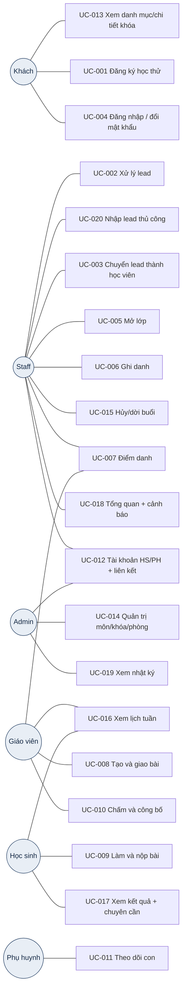

# 04 — Use Case Catalogue (Pha 1)

| Mục | Giá trị |
|---|---|
| Phiên bản | 3.1 (2026-10-21) — tách mỗi UC một file theo `USE_CASE_TEMPLATE`; thêm UC-013..UC-020 cho các FR chưa có UC |
| Owner | Trợ lý (Use Case Writer) · Phê duyệt: chủ dự án |
| Thư mục chi tiết | [04-use-cases/](04-use-cases/) |

## 1. Sơ đồ actor – use case

Admin thực hiện được mọi UC của Staff. Mọi actor đã đăng nhập dùng UC-004.

## 2. Danh mục

| UC | Tên | Actor chính | FR | Ưu tiên | File |
|---|---|---|---|---|---|
| UC-001 | Đăng ký học thử | Khách | FR-004, FR-005 | P0 | [UC-001](04-use-cases/UC-001-dang-ky-hoc-thu.md) |
| UC-002 | Xử lý lead (lọc, trạng thái, ghi chú) | Staff/Admin | FR-006..FR-008 | P0 | [UC-002](04-use-cases/UC-002-xu-ly-lead.md) |
| UC-003 | Chuyển lead thành học viên | Staff/Admin | FR-009, FR-019 | P0 | [UC-003](04-use-cases/UC-003-chuyen-lead.md) |
| UC-004 | Đăng nhập, đăng xuất, đổi mật khẩu | Mọi người dùng | FR-010..FR-012 | P0 | [UC-004](04-use-cases/UC-004-dang-nhap.md) |
| UC-005 | Mở lớp và quản lý trạng thái lớp | Staff/Admin | FR-017, FR-018 | P0 | [UC-005](04-use-cases/UC-005-mo-lop.md) |
| UC-006 | Ghi danh và đổi trạng thái ghi danh | Staff/Admin | FR-019, FR-020 | P0 | [UC-006](04-use-cases/UC-006-ghi-danh.md) |
| UC-007 | Điểm danh buổi học | GV; Staff/Admin | FR-023, FR-024 | P0 | [UC-007](04-use-cases/UC-007-diem-danh.md) |
| UC-008 | Tạo và giao bài tập | GV | FR-027, FR-028 | P0 | [UC-008](04-use-cases/UC-008-tao-bai-tap.md) |
| UC-009 | Làm và nộp bài | HS | FR-029, FR-030 | P0 | [UC-009](04-use-cases/UC-009-lam-bai.md) |
| UC-010 | Chấm và công bố kết quả | GV | FR-031..FR-033 | P0 | [UC-010](04-use-cases/UC-010-cham-cong-bo.md) |
| UC-011 | Phụ huynh theo dõi con | PH | FR-022, FR-025, FR-033, FR-034 | P0 | [UC-011](04-use-cases/UC-011-phu-huynh-theo-doi.md) |
| UC-012 | Quản trị người dùng và liên kết phụ huynh | Admin; Staff (HS/PH) | FR-013, FR-014 | P1 | [UC-012](04-use-cases/UC-012-quan-tri-nguoi-dung.md) |
| UC-013 | Xem danh mục và chi tiết khóa học | Khách | FR-001..FR-003 | P0 | [UC-013](04-use-cases/UC-013-xem-khoa-hoc.md) |
| UC-014 | Quản trị môn, khóa, phòng | Admin | FR-015, FR-016 | P1 | [UC-014](04-use-cases/UC-014-quan-tri-danh-muc.md) |
| UC-015 | Hủy hoặc dời buổi học | Staff/Admin | FR-021 | P1 | [UC-015](04-use-cases/UC-015-huy-doi-buoi.md) |
| UC-016 | Xem lịch tuần | GV, HS, PH | FR-022 | P0 | [UC-016](04-use-cases/UC-016-lich-tuan.md) |
| UC-017 | Học sinh xem kết quả và chuyên cần | HS | FR-025, FR-033 | P0 | [UC-017](04-use-cases/UC-017-ket-qua-hoc-sinh.md) |
| UC-018 | Xem tổng quan theo vai trò và cảnh báo vắng | Admin, Staff, GV, HS | FR-026, FR-034 | P0 | [UC-018](04-use-cases/UC-018-tong-quan.md) |
| UC-019 | Xem nhật ký audit | Admin | FR-035 | P1 | [UC-019](04-use-cases/UC-019-nhat-ky.md) |
| UC-020 | Nhập lead thủ công | Staff/Admin | FR-006 | P0 | [UC-020](04-use-cases/UC-020-nhap-lead.md) |

## 3. Ma trận luồng thay thế / ngoại lệ (tóm tắt cho QA)

| UC | Luồng thay thế | Ngoại lệ chính |
|---|---|---|
| UC-001 | Trùng lead mở → RESUBMITTED; vào từ trang khóa → khóa điền sẵn | Validate, rate limit, honeypot |
| UC-002 | Lọc quá hạn; mở lại lead LOST | Chuyển sai luồng, thiếu lý do LOST, cập nhật đồng thời |
| UC-003 | Dùng lại phụ huynh theo SĐT; không chọn lớp; HS không có email/SĐT | SĐT thuộc vai trò khác, trùng email/SĐT, lớp đầy/trùng lịch/đóng |
| UC-004 | `mustChangePassword` → đổi mật khẩu | Sai thông tin, khóa tài khoản, khóa IP, DISABLED |
| UC-005 | Không xếp phòng; đổi trạng thái lớp | Trùng GV/phòng, sĩ số > phòng, mã lớp trùng, giờ sai |
| UC-006 | Ghi danh lại HS từng nghỉ; ghi danh nhiều HS | Đầy, đã ghi danh, trùng lịch HS, lớp đóng, HS bị khóa |
| UC-007 | Staff ngoài khung + lý do; GV dạy thay | GV ngoài khung, buổi hủy, thiếu lý do |
| UC-008 | Đóng/mở lại bài; sửa hạn | Giao bài không có câu/hạn quá khứ, sửa câu khi đã giao |
| UC-009 | Lưu nháp; nộp muộn | Nộp lần 2, quá hạn không cho muộn, không còn ACTIVE, bài đóng |
| UC-010 | Sửa điểm sau công bố (audit); công bố khi còn bài chưa chấm | Điểm ngoài khoảng/lệch bước, chưa nộp, bài nháp |
| UC-011 | Nhiều con → chọn con | Con không liên kết → 404; chưa liên kết con |
| UC-012 | Staff tạo HS/PH; đổi vai trò | Trùng email/SĐT, không có thông tin đăng nhập, tự khóa, PH thứ 5 |
| UC-013 | Lọc môn/khối | Khóa ẩn → 404; không kết quả |
| UC-014 | Ẩn khóa thay vì xóa | Slug trùng, xóa khóa có lớp/môn có khóa/phòng đang dùng |
| UC-015 | — | Buổi không còn SCHEDULED, trùng lịch, thời điểm quá khứ |
| UC-016 | Chuyển tuần | Tuần trống |
| UC-019 | Lọc theo loại | Staff truy cập → về tổng quan |
| UC-020 | — | Trùng SĐT lead đang mở |
