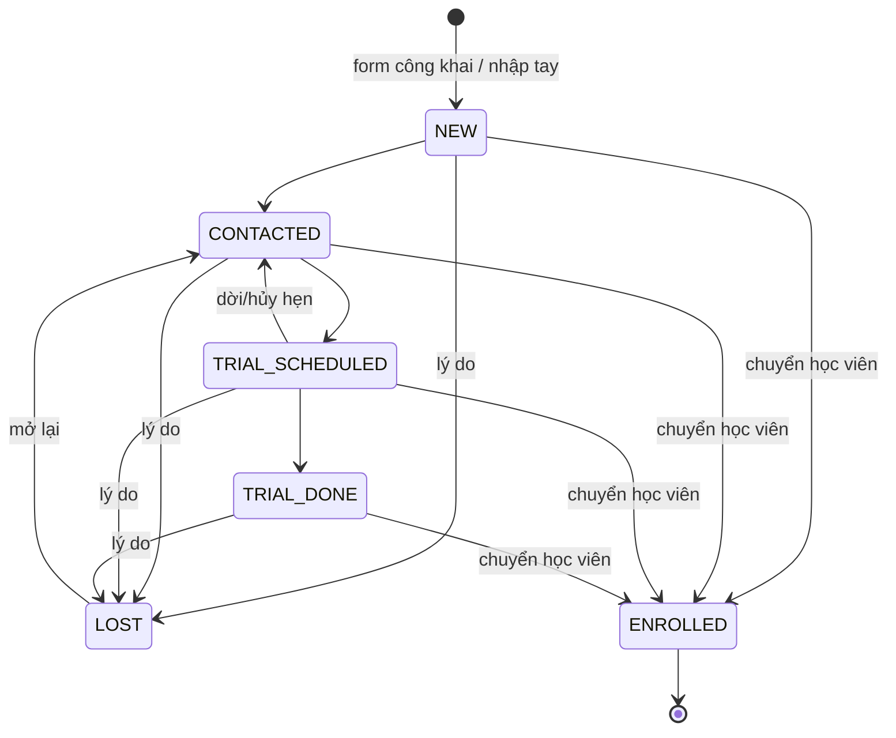
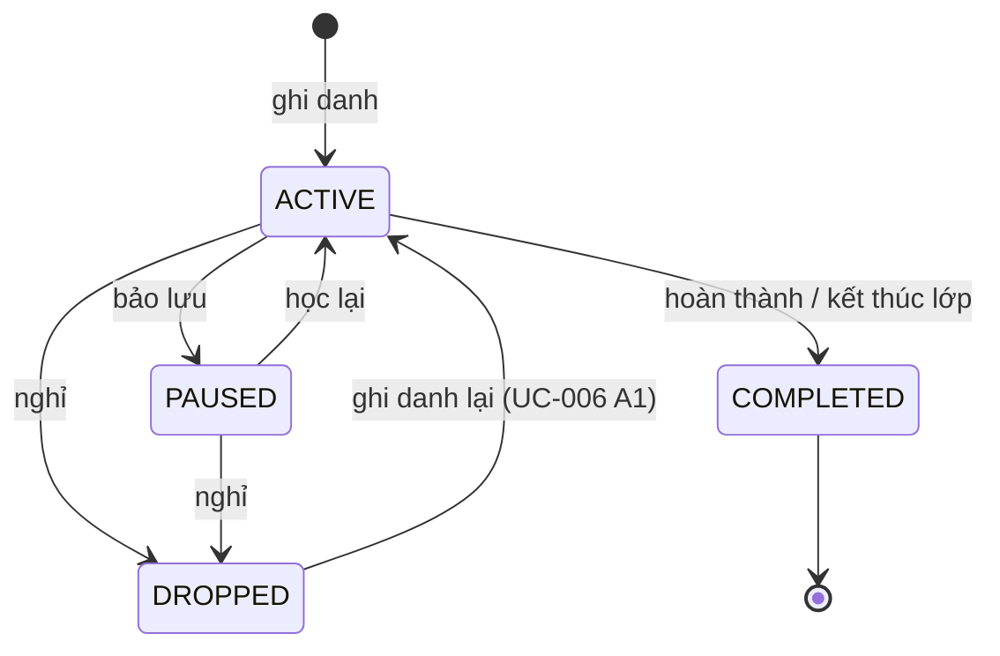
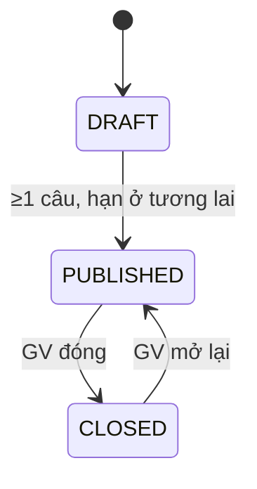
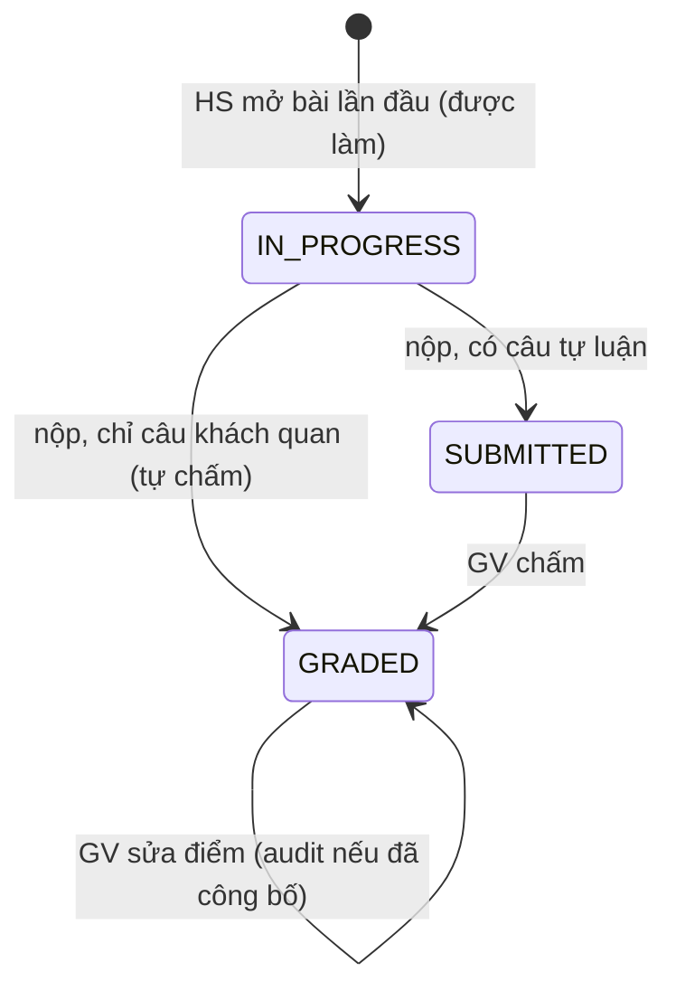

# 06 — Quy tắc nghiệp vụ và máy trạng thái

| Mục | Giá trị |
|---|---|
| Phiên bản | 3.1 (2026-10-21) — thêm BR-009, 011..016, 024..028, 034, 047..051; cột "Thực thi tại" và "Test" |
| Owner | Trợ lý (BA + Requirements Engineer) · Phê duyệt: chủ dự án |
| Nguồn chuẩn | Tài liệu này. Code tham chiếu ID BR trong comment |

ID cố định; BR mới lấy số trống trong nhóm. Nhóm: 001–019 tuyển sinh & tài khoản · 020–029 lớp/ghi danh/buổi · 030–039 điểm danh · 040–049 khảo thí · 050–059 quản trị.

## 1. Danh mục quy tắc

### 1.1 Tuyển sinh và tài khoản

| ID | Quy tắc | Điều kiện → kết quả | Áp dụng | Thực thi tại | Test |
|---|---|---|---|---|---|
| BR-001 | SĐT Việt Nam chuẩn hóa | Bỏ khoảng trắng/chấm/gạch/ngoặc; `0xxxxxxxxx` → `+84xxxxxxxxx`; `84…` → `+84…`; sau chuẩn hóa phải khớp `^\+84[35789]\d{8}$`, sai → lỗi | Lead, user | `src/lib/phone.ts` | TC-001 |
| BR-002 | Rate limit form học thử | Cửa sổ cố định 10 phút theo khóa `trial:<ip>`; lần thứ 6 trong cửa sổ bị từ chối; hết cửa sổ → đếm lại | FR-005 | `src/server/rate-limit/rules.ts`, `limiter.ts` | TC-004 |
| BR-003 | Lead quá hạn | `status = NEW` và `now − createdAt > 24h` | FR-006, FR-034 | `src/server/leads/rules.ts` | TC-005 (nhóm) |
| BR-004 | Lead đang mở | `status ∉ {ENROLLED, LOST}` | FR-004, FR-006 | `leads/rules.ts`, `leads/service.ts` | TC-003 |
| BR-005 | Khóa đăng nhập | Sai lần thứ 5 liên tiếp → `lockedUntil = now + 15'`, bộ đếm về 0; đúng mật khẩu → bộ đếm về 0; trong thời gian khóa từ chối trước khi kiểm tra mật khẩu | FR-011 | `src/server/auth/rules.ts` | TC-010 |
| BR-006 | Độ mạnh mật khẩu | 8–128 ký tự, có ít nhất một chữ (Unicode) và một chữ số | FR-012 | `auth/rules.ts` | TC-011 |
| BR-007 | Mã học sinh | `HS` + 2 số cuối năm (UTC) + 4 số tăng dần theo năm (vd `HS260001`); duy nhất; va chạm → thử lại ≤ 3 lần | FR-009, FR-013 | `src/server/users/credentials.ts` | `credentials.test.ts` |
| BR-008 | Số phụ huynh | Một HS tối đa 4 PH; không liên kết trùng | FR-014 | `users/rules.ts`, `users/service.ts` (khóa dòng HS) | TC-037 |
| BR-009 | Rate limit đăng nhập theo IP | Khóa `login:<ip>`, 20 lần/10 phút (cửa sổ cố định); lần 21 bị từ chối, không kiểm tra mật khẩu | FR-011 | `rate-limit/rules.ts` (`LOGIN_LIMIT`), `auth/actions.ts` | TC-043 |
| BR-010 | Máy trạng thái lead | Bảng §2.1; ENROLLED chỉ đạt qua chuyển học viên | FR-007, FR-009 | `leads/rules.ts` | TC-005, TC-006 |
| BR-011 | Trùng lead khi nhập tay | Có lead đang mở cùng SĐT → từ chối `DUPLICATE_OPEN_LEAD` kèm id lead đó (khác BR-004 của form công khai là gộp âm thầm) | FR-006 | `leads/service.ts` | TC-040 |
| BR-012 | Nguồn lead | `web_form` (chỉ form công khai), `phone`, `walk_in`, `referral`, `other` (nhập tay) | FR-006 | `leads/schemas.ts` | TC-045 |
| BR-013 | Lý do mất lead | Vào LOST bắt buộc lý do (≤ 255, lưu `lostReason`); rời LOST → `lostReason = null` | FR-007 | `leads/service.ts` | TC-006 |
| BR-014 | Thông tin đăng nhập | Mỗi tài khoản cần email hoặc SĐT để đăng nhập (trừ HS tạo từ lead không có — DECISION-D12); email/SĐT duy nhất toàn hệ thống; email lưu chữ thường | FR-010, FR-013 | `users/service.ts`, unique DB | TC-036 |
| BR-015 | Mật khẩu tạm | 10 ký tự từ bảng chữ/số bỏ ký tự dễ nhầm (0/O, 1/l/I), luôn có ≥ 1 chữ và ≥ 1 số; tài khoản → `mustChangePassword = true`; chỉ hiển thị một lần | FR-009, FR-013 | `credentials.ts` | `credentials.test.ts` |
| BR-016 | Chống ghi đè đồng thời | Cập nhật trạng thái lead/ghi danh dùng `updateMany where status = <trạng thái đã đọc>`; 0 dòng → `STALE` | FR-007, FR-020 | `leads/service.ts`, `academic/service.ts` | Review |

### 1.2 Lớp, ghi danh, buổi

| ID | Quy tắc | Điều kiện → kết quả | Áp dụng | Thực thi tại | Test |
|---|---|---|---|---|---|
| BR-020 | Sĩ số | Sĩ số = ghi danh ACTIVE + PAUSED; đạt `capacity` → không ghi danh thêm | FR-019, FR-003 | `academic/rules.ts`, `enrollment.ts` | TC-016 |
| BR-021 | Trùng lịch | Hai buổi trùng khi `a.startsAt < b.endsAt && b.startsAt < a.endsAt` (chạm biên không trùng); buổi CANCELLED không tính | FR-018, FR-019, FR-021 | `src/lib/schedule.ts` | TC-014 |
| BR-022 | Lớp đóng | Không ghi danh vào lớp COMPLETED/CANCELLED | FR-019 | `academic/rules.ts` | TC-017 |
| BR-023 | Sinh buổi | Duyệt từng ngày từ `startDate`, lấy ngày có thứ ∈ `weekdays` (1 = Thứ Hai … 7 = Chủ nhật) đến khi đủ `totalSessions`; giờ hiểu theo giờ VN rồi đổi UTC; `index` 1..N | FR-017 | `src/lib/schedule.ts` | TC-013 |
| BR-024 | Sức chứa phòng | Nếu có phòng: `capacity lớp ≤ capacity phòng` | FR-017 | `academic/service.ts` | TC-UAT-04 |
| BR-025 | Hệ quả trạng thái lớp | → COMPLETED: mọi ghi danh ACTIVE → COMPLETED. → CANCELLED: mọi buổi SCHEDULED có `startsAt > now` → CANCELLED, lý do "Lớp bị hủy" | FR-017, FR-020 | `academic/service.ts` | Review |
| BR-026 | Trạng thái ghi danh | Bảng §2.3; chỉ ACTIVE được làm bài; ghi lại HS DROPPED = kích hoạt lại bản ghi cũ | FR-020 | `academic/rules.ts`, `enrollment.ts` | TC-018 |
| BR-027 | Xóa lớp | Chỉ khi chưa có ghi danh nào (kể cả DROPPED); xóa cascade buổi, bài tập | FR-017 | `academic/service.ts` | Review |
| BR-028 | Hủy/dời buổi | Chỉ buổi SCHEDULED; dời: thời điểm mới ở tương lai, giờ kết thúc > bắt đầu, không trùng GV/phòng (bỏ qua chính buổi); lý do 3–255 bắt buộc; cả hai ghi audit | FR-021 | `academic/service.ts`, `actions.ts` | TC-047 |
| BR-029 | Học sinh được ghi danh | Tài khoản STUDENT, `status = ACTIVE` | FR-019 | `academic/service.ts` | TC-044 |

### 1.3 Điểm danh

| ID | Quy tắc | Điều kiện → kết quả | Áp dụng | Thực thi tại | Test |
|---|---|---|---|---|---|
| BR-030 | Khung điểm danh GV | `startsAt − 30' ≤ now ≤ endsAt + 24h` (bao gồm biên) | FR-023 | `attendance/rules.ts` | TC-019 |
| BR-031 | Ngoài khung | Chỉ STAFF/ADMIN; bắt buộc lý do; audit `attendance.override` với `before`, `after` | FR-024 | `attendance/rules.ts`, `service.ts` | TC-020 |
| BR-032 | Tỷ lệ chuyên cần | (PRESENT + LATE) / số bản ghi của các buổi không bị hủy; không có bản ghi → "Chưa có dữ liệu" | FR-025 | `attendance/rules.ts` | TC-021 |
| BR-033 | Cảnh báo vắng | Với mỗi lớp OPEN/IN_PROGRESS: 2 buổi không hủy gần nhất **đã có điểm danh**; HS ABSENT ở cả hai → cảnh báo (EXCUSED không tính) | FR-026 | `attendance/rules.ts`, `service.ts` | TC-022 |
| BR-034 | Hoàn tất buổi | Lưu điểm danh khi `now > endsAt` và buổi SCHEDULED → COMPLETED | FR-023 | `attendance/service.ts` | Review |
| BR-035 | Danh sách điểm danh | HS ghi danh ACTIVE + HS đã có bản ghi ở buổi; server chỉ nhận HS có ghi danh ở lớp | FR-023 | `attendance/service.ts` | Review |

### 1.4 Khảo thí

| ID | Quy tắc | Điều kiện → kết quả | Áp dụng | Thực thi tại | Test |
|---|---|---|---|---|---|
| BR-040 | Chấm trắc nghiệm | Chọn đúng `correctOption` → đủ điểm câu; sai/bỏ trống → 0 | FR-030 | `src/lib/grading.ts` | TC-026 |
| BR-041 | Chấm trả lời ngắn | Đúng khi `normalize(response) ∈ normalize(acceptedAnswers)`; normalize = Unicode NFC, trim, gộp khoảng trắng, chữ thường (locale vi); bỏ trống → 0 | FR-030 | `grading.ts` | TC-027 |
| BR-042 | Điểm GV nhập | `0 ≤ điểm ≤ điểm câu`, bước 0,25; tự luận bắt buộc nhập | FR-031 | `grading.ts`, `assessment/service.ts` | TC-030 |
| BR-043 | Điểm bài | Σ (teacherPoints ?? autoPoints ?? 0), làm tròn 2 chữ số (DECISION-D10) | FR-031 | `grading.ts` | TC-031 |
| BR-044 | Nộp muộn | `now > dueAt` → chỉ nộp khi `allowLate`, đánh dấu `isLate` | FR-029 | `grading.ts` | TC-028 |
| BR-045 | Một bài nộp | Unique `(assignmentId, studentId)`; nộp là một chiều; `updateMany where IN_PROGRESS` | FR-029 | DB + `assessment/service.ts` | TC-028 |
| BR-046 | Công bố | Điểm, đáp án đúng, nhận xét chỉ trả cho HS/PH khi `resultsPublishedAt ≠ null` | FR-032 | `grading.ts`, `assessment/service.ts` | TC-032, TC-033 |
| BR-047 | Hiển thị điểm từng bài nộp | Hiển thị cho HS/PH khi BR-046 **và** `submission.status = GRADED`; bài SUBMITTED → "Đang chờ chấm" (DECISION-D15) | FR-032, FR-033 | `grading.ts` (`submissionResultVisible`) | TC-042 |
| BR-048 | Câu hỏi hợp lệ | Điểm 0,25–100 bước 0,25; MCQ 2–6 lựa chọn không trống, đúng một đáp án trong phạm vi; SHORT ≥ 1 đáp án chấp nhận | FR-027 | `grading.ts` | TC-025 |
| BR-049 | Máy trạng thái bài | Bảng §2.5; DRAFT → PUBLISHED cần ≥ 1 câu và `dueAt > now`; chỉ sửa câu khi DRAFT; đổi hạn bài đã giao phải ở tương lai | FR-028 | `grading.ts`, `assessment/service.ts` | TC-023, TC-024 |

### 1.5 Quản trị

| ID | Quy tắc | Điều kiện → kết quả | Áp dụng | Thực thi tại | Test |
|---|---|---|---|---|---|
| BR-050 | Xóa danh mục | Khóa có lớp → không xóa (chỉ ẩn); môn có khóa → không xóa; phòng có lớp/buổi → không xóa; xóa khóa/môn → lead tham chiếu đặt `null` | FR-015, FR-016 | `catalog/admin.ts` | TC-041 |
| BR-051 | Bảo vệ quản trị và phiên | Admin không tự khóa/tự đổi vai trò; khóa, đổi vai trò, đặt lại mật khẩu → thu hồi mọi phiên của người đó; đổi mật khẩu → thu hồi phiên khác (giữ phiên hiện tại) | FR-012, FR-013 | `auth/policy.ts`, `users/service.ts`, `auth/actions.ts` | TC-038 |

## 2. Máy trạng thái

### 2.1 Lead (BR-010)

| Từ \ Sang | CONTACTED | TRIAL_SCHEDULED | TRIAL_DONE | LOST | ENROLLED |
|---|---|---|---|---|---|
| NEW | ✓ | — | — | ✓ lý do | ✓ UC-003 |
| CONTACTED | — | ✓ | — | ✓ lý do | ✓ UC-003 |
| TRIAL_SCHEDULED | ✓ | — | ✓ | ✓ lý do | ✓ UC-003 |
| TRIAL_DONE | — | — | — | ✓ lý do | ✓ UC-003 |
| LOST | ✓ (xóa lý do) | — | — | — | — |
| ENROLLED | — (cuối) | — | — | — | — |

Ai: STAFF, ADMIN. Mỗi chuyển ghi hoạt động `STATUS_CHANGE`; chuyển học viên ghi `CONVERTED` + audit. Đồng thời: BR-016.

### 2.2 Lớp

| Từ | Sang | Ai | Điều kiện | Hệ quả (BR-025) |
|---|---|---|---|---|
| OPEN | IN_PROGRESS | Staff/Admin | — | — |
| OPEN, IN_PROGRESS | COMPLETED | Staff/Admin | Xác nhận | Ghi danh ACTIVE → COMPLETED |
| OPEN, IN_PROGRESS | CANCELLED | Staff/Admin | Xác nhận | Buổi SCHEDULED tương lai → CANCELLED |
| COMPLETED, CANCELLED | — | — | Trạng thái cuối | — |

Xóa lớp: BR-027. Trang công khai chỉ hiện lớp OPEN.

### 2.3 Ghi danh (BR-026)

| Trạng thái | Tính sĩ số | Làm bài | Thấy lịch | Thấy bài đã giao/điểm | Trong danh sách điểm danh |
|---|---|---|---|---|---|
| ACTIVE | ✓ | ✓ | ✓ | ✓ | ✓ |
| PAUSED | ✓ | — | ✓ | ✓ (chỉ xem) | chỉ khi đã có bản ghi |
| DROPPED | — | — | — | ✓ (lịch sử) | chỉ khi đã có bản ghi |
| COMPLETED | — | — | — | ✓ (lịch sử) | chỉ khi đã có bản ghi |

DROPPED → ACTIVE chỉ qua thao tác ghi danh (kiểm tra lại BR-020..022, 029), không qua "Đổi trạng thái".

### 2.4 Buổi học

| Từ | Sang | Ai / sự kiện | Điều kiện |
|---|---|---|---|
| SCHEDULED | COMPLETED | Lưu điểm danh (GV/Staff) | `now > endsAt` (BR-034) |
| SCHEDULED | CANCELLED | Staff/Admin hủy buổi; hoặc hủy lớp | Lý do (BR-028); hủy lớp chỉ buổi tương lai |
| SCHEDULED | SCHEDULED (giờ mới) | Staff/Admin dời buổi | BR-028 |
| COMPLETED | — | Vẫn sửa điểm danh được (GV trong khung, Staff ngoài khung) | — |
| CANCELLED | — | Cuối; không điểm danh | — |

### 2.5 Bài tập (BR-049)

`resultsPublishedAt` là cờ độc lập: đặt được khi bài PUBLISHED/CLOSED, một lần, không thu hồi ở Pha 1.

| Trạng thái | Sửa câu | Sửa thông tin | HS thấy | HS làm/nộp |
|---|---|---|---|---|
| DRAFT | ✓ | ✓ | — (404) | — |
| PUBLISHED | — | ✓ (hạn mới ở tương lai) | ✓ | ✓ (ACTIVE, BR-044) |
| CLOSED | — | ✓ | ✓ | — |

### 2.6 Bài nộp

### 2.7 Tài khoản

| Từ | Sang | Ai | Hệ quả |
|---|---|---|---|
| — | ACTIVE + `mustChangePassword` | Admin/Staff tạo, chuyển lead | Mật khẩu tạm hiển thị một lần |
| ACTIVE | DISABLED | Admin (không phải chính mình) | Thu hồi phiên; audit |
| DISABLED | ACTIVE | Admin | Xóa khóa tạm; audit |
| `mustChangePassword` = true | false | Chính người dùng đổi mật khẩu | Thu hồi phiên khác |

## 3. Đồng thời, thời gian, retry

| Tình huống | Cơ chế | Kết quả |
|---|---|---|
| Hai Staff ghi danh chỗ cuối | `SELECT … FROM classes … FOR UPDATE` trong transaction + unique `(classId, studentId)` | Người sau nhận `CLASS_FULL` |
| Hai Staff liên kết PH thứ 4 và 5 | `SELECT … FROM users … FOR UPDATE` (dòng HS) | Người sau nhận `MAX_GUARDIANS` |
| HS bấm nộp hai lần / hai tab | `updateMany where status = IN_PROGRESS` | Lần hai nhận `ALREADY_SUBMITTED` |
| Hai người đổi trạng thái lead/ghi danh | BR-016 | `STALE` |
| Hai chuyển lead cùng lúc sinh cùng mã HS | Unique `studentCode` + thử lại ≤ 3 lần | Mã khác nhau |
| Hai request đầu tiên tạo cùng bucket rate limit | Unique `key`; request thua chạy lại | Đếm đúng |
| Hai GV/Staff lưu điểm danh cùng buổi | Upsert theo unique `(sessionId, studentId)` | Bản ghi sau thắng (chấp nhận) |
| HS mở bài lần đầu ở hai tab | `create` lỗi unique → đọc lại bản đã có | Một submission |
| Múi giờ | DB UTC; nhập/hiển thị giờ VN chỉ qua `src/lib/time.ts`; VN không có giờ mùa hè | — |
| Hết hạn | Phiên 7 ngày; khóa tạm 15'; cửa sổ rate limit 10'; lead quá hạn 24h; khung điểm danh | So sánh với `new Date()` phía server |
