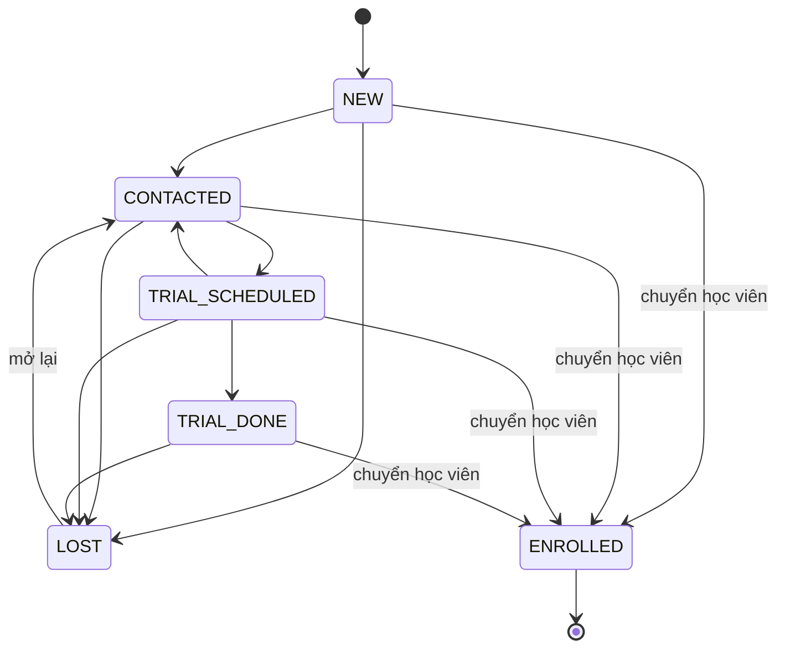
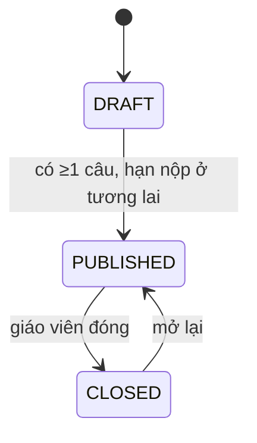

# 06 — Quy tắc nghiệp vụ và máy trạng thái

## 1. Quy tắc nghiệp vụ

| ID | Quy tắc | Áp dụng |
|---|---|---|
| BR-001 | SĐT Việt Nam chuẩn hóa: bỏ khoảng trắng/dấu chấm/gạch; `0xxxxxxxxx` → `+84xxxxxxxxx`; `84…` → `+84…`; sau chuẩn hóa phải khớp `^\+84[35789]\d{8}$` | Lead, user |
| BR-002 | Rate limit form công khai: 5 lần / 10 phút / IP | FR-005 |
| BR-003 | Lead "quá hạn" khi status NEW và `createdAt` cũ hơn 24 giờ | FR-006 |
| BR-004 | Lead được xem là "đang mở" khi status ∉ {ENROLLED, LOST} | FR-004 |
| BR-005 | Khóa đăng nhập 15 phút sau 5 lần sai liên tiếp; đăng nhập đúng reset bộ đếm | FR-011 |
| BR-006 | Mật khẩu tối thiểu 8 ký tự, có chữ và số | FR-012 |
| BR-007 | Mã học sinh dạng `HS` + năm 2 số + 4 số tăng dần (vd `HS260001`) | FR-009, FR-013 |
| BR-008 | Một học sinh có tối đa 4 phụ huynh liên kết | FR-014 |
| BR-020 | Sĩ số = số ghi danh ACTIVE + PAUSED; đạt `capacity` thì không ghi danh thêm | FR-019 |
| BR-021 | Hai buổi trùng khi `a.startsAt < b.endsAt && b.startsAt < a.endsAt` (buổi CANCELLED không tính) | FR-018, FR-019 |
| BR-022 | Không ghi danh vào lớp COMPLETED hoặc CANCELLED | FR-019 |
| BR-023 | Sinh buổi: duyệt từng ngày từ `startDate`, lấy ngày có thứ nằm trong `weekdays` (1=Thứ Hai … 7=Chủ nhật), đến khi đủ `totalSessions`; giờ hiểu theo `Asia/Ho_Chi_Minh` rồi đổi sang UTC | FR-017 |
| BR-030 | Khung điểm danh của giáo viên: từ `startsAt − 30 phút` đến `endsAt + 24 giờ` | FR-023 |
| BR-031 | Ngoài khung: chỉ STAFF/ADMIN, bắt buộc lý do, ghi audit | FR-024 |
| BR-032 | Tỷ lệ chuyên cần = (PRESENT + LATE) / số bản ghi điểm danh của các buổi không bị hủy | FR-025 |
| BR-033 | Cảnh báo vắng: 2 buổi đã điểm danh gần nhất (không bị hủy) của cùng lớp đều ABSENT | FR-026 |
| BR-040 | Trắc nghiệm: đúng khi chọn đúng `correctOption` → đủ điểm, sai → 0 | FR-030 |
| BR-041 | Trả lời ngắn: đúng khi `normalize(response)` thuộc `normalize(acceptedAnswers)`; normalize = trim, gộp khoảng trắng, chữ thường, chuẩn Unicode NFC | FR-030 |
| BR-042 | Tự luận: điểm do giáo viên nhập, 0 ≤ điểm ≤ điểm câu, bước 0.25 | FR-031 |
| BR-043 | Điểm bài = tổng (teacherPoints ?? autoPoints ?? 0), làm tròn 2 chữ số | FR-031 |
| BR-044 | Nộp muộn: `now > dueAt` → chỉ được nộp khi `allowLate`, đánh dấu `isLate` | FR-029 |
| BR-045 | Mỗi học sinh một submission cho mỗi bài (unique); nộp là không thể hoàn tác | FR-029 |
| BR-046 | Kết quả chỉ hiển thị cho HS/PH khi `resultsPublishedAt` có giá trị | FR-032 |

## 2. Máy trạng thái

### Lead (BR-010)

ENROLLED chỉ đạt được qua UC-003. Người chuyển: STAFF, ADMIN.

### Lớp
| Từ | Sang | Ai | Điều kiện |
|---|---|---|---|
| OPEN | IN_PROGRESS | Staff/Admin | — |
| OPEN/IN_PROGRESS | COMPLETED | Staff/Admin | Ghi danh ACTIVE → COMPLETED |
| OPEN/IN_PROGRESS | CANCELLED | Staff/Admin | Các buổi chưa diễn ra → CANCELLED |

### Ghi danh
ACTIVE ↔ PAUSED; ACTIVE/PAUSED → DROPPED; ACTIVE → COMPLETED. DROPPED/COMPLETED là trạng thái cuối. Ai: Staff/Admin.

### Buổi học
SCHEDULED → COMPLETED (khi điểm danh sau giờ kết thúc) · SCHEDULED → CANCELLED (Staff/Admin, lý do).

### Bài tập

`resultsPublishedAt` là cờ độc lập, chỉ đặt được khi bài đã PUBLISHED/CLOSED.

### Bài nộp
IN_PROGRESS → SUBMITTED (có câu tự luận) → GRADED · IN_PROGRESS → GRADED (chỉ câu khách quan, chấm tự động ngay).

## 3. Đồng thời

- Ghi danh: kiểm tra sĩ số và insert trong cùng transaction; unique `(classId, studentId)` chặn trùng.
- Nộp bài: `updateMany where status = IN_PROGRESS` — chỉ một request thắng.
- Mã học sinh: sinh trong transaction và dựa trên unique `studentCode`; va chạm → thử lại tối đa 3 lần.
