# 07 — Sitemap, hành trình người dùng và sơ đồ logic

| Mục | Giá trị |
|---|---|
| Phiên bản | 3.1 (2026-10-21) |
| Trạng thái sơ đồ | §1–§3, §5–§10: **đã đối chiếu với code** (chưa chạy trên DB thật — RISK-007). Phần đánh dấu *(bổ sung P3)* là hành vi thêm trong phiên 3 |
| Owner | Trợ lý (BA + Process Analyst) |

## 1. Sitemap

```text
Công khai (PublicShell: header Khóa học · Học thử · Đăng nhập; footer)
  /                               SCREEN-001 Trang chủ (FR-001)
  /khoa-hoc?mon=&khoi=            SCREEN-002 Danh mục (FR-002)
  /khoa-hoc/[slug]                SCREEN-003 Chi tiết khóa (FR-003)
  /dang-ky-hoc-thu?khoa=          SCREEN-004 Form học thử (FR-004)
  /dang-ky-hoc-thu/cam-on         SCREEN-005 Cảm ơn (noindex)
  /dang-nhap                      SCREEN-006 Đăng nhập (noindex)
Mọi vai trò đã đăng nhập
  /doi-mat-khau                   SCREEN-007 (FR-012)
Quản lý — ADMIN, STAFF (AppShell, sidebar)
  /quan-ly                        SCREEN-008 Tổng quan (FR-034)
  /quan-ly/lead                   SCREEN-009 Danh sách lead (FR-006)
  /quan-ly/lead/moi               SCREEN-011 Nhập lead (FR-006)            (bổ sung P3)
  /quan-ly/lead/[id]              SCREEN-010 Chi tiết lead (FR-007..009)
  /quan-ly/lop                    SCREEN-012 Danh sách lớp
  /quan-ly/lop/moi                SCREEN-013 Mở lớp (FR-017, 018)
  /quan-ly/lop/[id]               SCREEN-014 Chi tiết lớp (FR-019..021)
  /quan-ly/buoi/[id]              SCREEN-015 Điểm danh quản lý (FR-024)
  /quan-ly/hoc-vien               SCREEN-016 Học viên + liên kết (FR-013, 014)
  — chỉ ADMIN —
  /quan-ly/nguoi-dung             SCREEN-017 Người dùng (FR-013)
  /quan-ly/nguoi-dung/[id]        SCREEN-018 Chi tiết người dùng
  /quan-ly/khoa-hoc               SCREEN-019 Khóa học (FR-015)
  /quan-ly/khoa-hoc/[id]          SCREEN-020 Sửa khóa
  /quan-ly/mon-hoc                SCREEN-021 Môn học
  /quan-ly/phong                  SCREEN-022 Phòng (FR-016)
  /quan-ly/nhat-ky                SCREEN-023 Nhật ký (FR-035)
Giáo viên — TEACHER (sidebar ≥1024px, thanh đáy < 1024px)
  /giao-vien                      SCREEN-024 Tổng quan
  /giao-vien/lich?tuan=           SCREEN-025 Lịch dạy (FR-022)
  /giao-vien/lop                  SCREEN-026 Lớp của tôi
  /giao-vien/lop/[id]             SCREEN-027 Chi tiết lớp + bảng điểm (FR-033)
  /giao-vien/buoi/[id]            SCREEN-028 Điểm danh (FR-023)
  /giao-vien/bai-tap/moi?lop=     SCREEN-029 Tạo bài (FR-027)
  /giao-vien/bai-tap/[id]         SCREEN-030 Soạn/giao/công bố (FR-027, 028, 032)
  /giao-vien/bai-tap/[id]/bai-nop SCREEN-031 Danh sách bài nộp
  /giao-vien/bai-nop/[id]         SCREEN-032 Chấm bài (FR-031)
Học sinh — STUDENT
  /hoc-sinh?tuan=                 SCREEN-033 Tổng quan
  /hoc-sinh/lich?tuan=            SCREEN-034 Lịch học
  /hoc-sinh/bai-tap               SCREEN-035 Bài tập
  /hoc-sinh/bai-tap/[id]          SCREEN-036 Làm bài / xem kết quả (FR-029..032)
  /hoc-sinh/ket-qua               SCREEN-037 Kết quả + chuyên cần (FR-025, 033)
Phụ huynh — PARENT
  /phu-huynh?con=&tuan=           SCREEN-038 Theo dõi con (FR-034)
Hệ thống
  404 · lỗi · loading             SCREEN-039
```

## 2. Kiểm tra truy cập cho mọi request nội bộ

Mục đích: một sơ đồ cho mọi trang và Server Action nội bộ (NFR-001). Actor: mọi người. UC: tất cả.

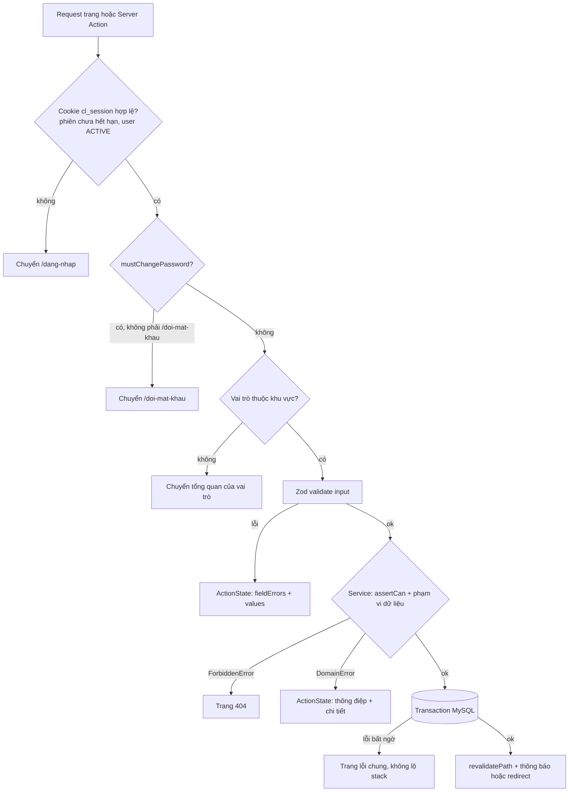

## 3. Đăng nhập và điều hướng (UC-004)

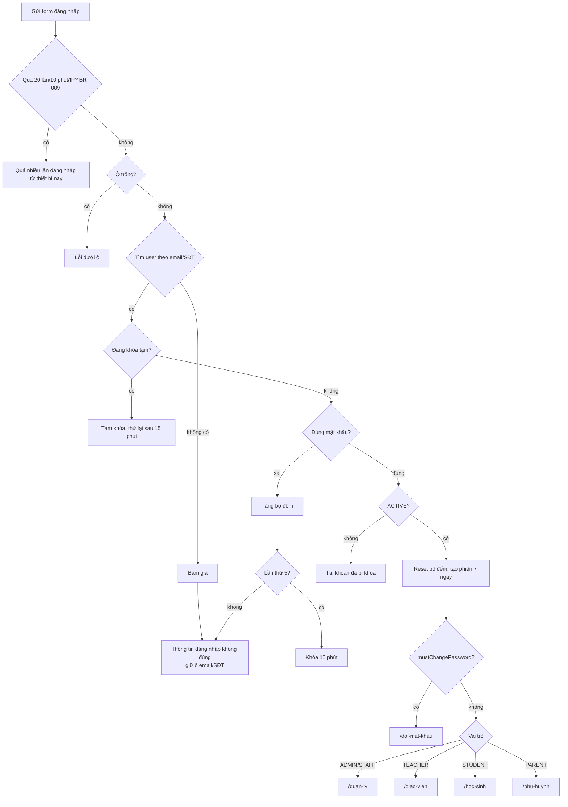

## 4. Hành trình theo cổng

### 4.1 Phụ huynh tiềm năng → học viên (xuyên vai trò, swimlane)

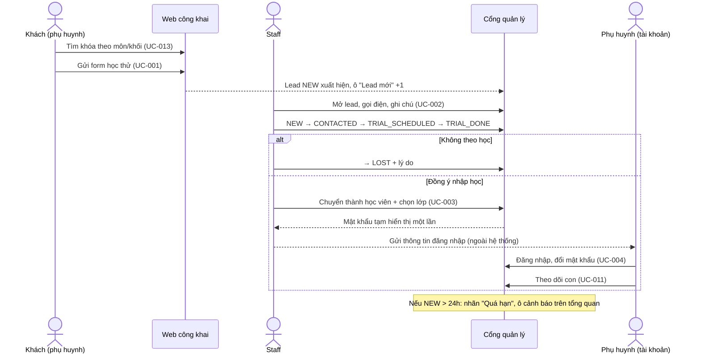

### 4.2 Giáo viên — một tuần dạy

1. Đăng nhập → `/giao-vien`: "Buổi dạy hôm nay".
2. Đến giờ (từ 30 phút trước) → "Điểm danh" → mặc định có mặt → chỉnh em vắng → Lưu (≤ 30 s).
3. Tối: `/giao-vien/lop/[id]` → "Tạo bài tập" → thêm câu → "Giao bài cho lớp".
4. Sau hạn: "Bài chờ chấm" → chấm tự luận → "Công bố kết quả".
5. Xem cảnh báo vắng 2 buổi liên tiếp → liên hệ gia đình / trung tâm.

### 4.3 Học sinh — làm bài

1. `/hoc-sinh` → "Bài cần làm" → mở bài → làm → "Lưu nháp" (tùy) → "Nộp bài" (xác nhận).
2. Sau khi GV công bố: `/hoc-sinh/ket-qua` → bấm tên bài → xem điểm, đáp án, nhận xét.

### 4.4 Quản trị viên (Admin) — một ngày (vai trò giáo vụ đã bỏ theo DECISION-D35)

1. `/quan-ly`: xử lý "Lead quá 24 giờ" → `/quan-ly/lead?quahan=1`.
2. Khách gọi điện → "Nhập lead" (UC-020).
3. Mở lớp mới (UC-005) → ghi danh HS (UC-006).
4. GV báo ốm → dời/hủy buổi (UC-015).
5. GV quên điểm danh quá 24h → `/quan-ly/buoi/[id]` sửa với lý do.

## 5. Đăng ký học thử (UC-001)

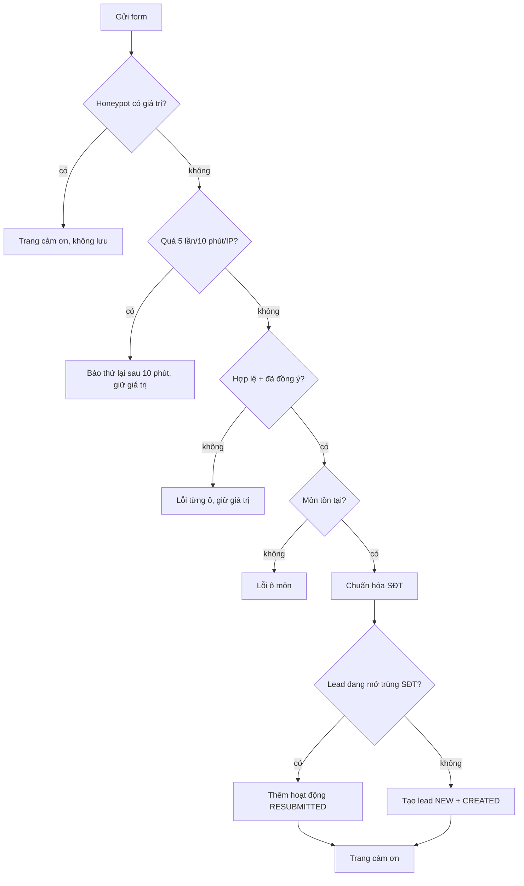

## 6. Nhập lead thủ công (UC-020) *(bổ sung P3)*

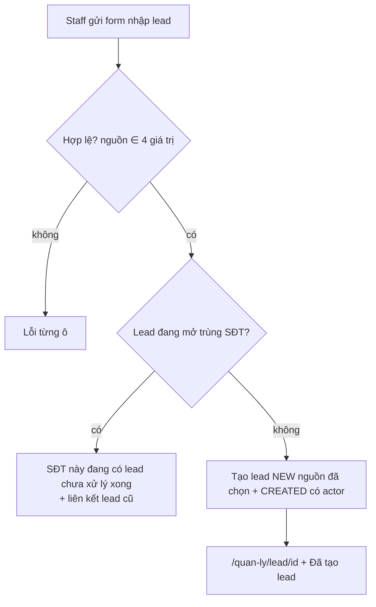

## 7. Chuyển lead thành học viên (UC-003)

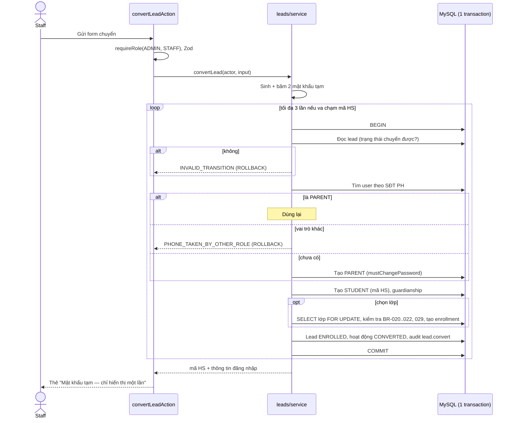

## 8. Mở lớp (UC-005) và ghi danh (UC-006)

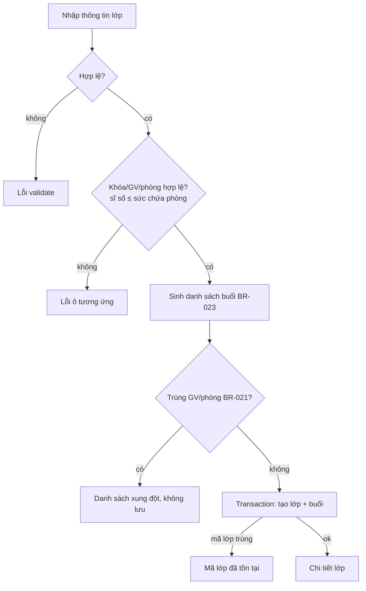

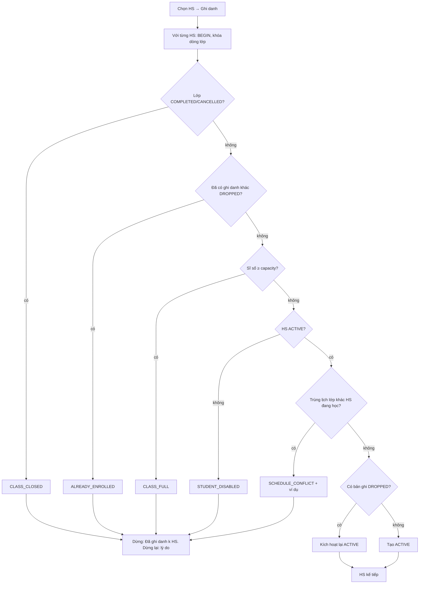

## 9. Điểm danh (UC-007)

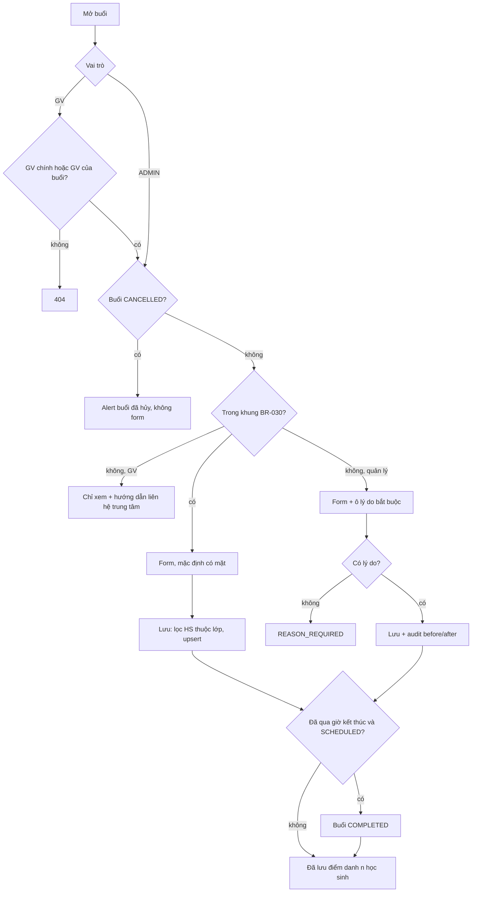

## 10. Bài tập: làm → chấm → công bố (UC-008..UC-010)

```mermaid
sequenceDiagram
  actor GV as Giáo viên
  participant S as Server
  actor HS as Học sinh
  actor PH as Phụ huynh
  GV->>S: Tạo bài DRAFT, thêm câu, giao (≥1 câu, hạn tương lai)
  HS->>S: Mở bài (ghi danh ACTIVE, bài PUBLISHED)
  S-->>HS: Câu hỏi qua toStudentQuestion() — KHÔNG có đáp án; tạo IN_PROGRESS
  HS->>S: Lưu nháp (upsert answers)
  HS->>S: Nộp
  alt đã nộp / quá hạn không cho muộn / không còn ACTIVE / bài đóng
    S-->>HS: Từ chối có thông điệp
  else hợp lệ
    S->>S: updateMany where IN_PROGRESS; tự chấm MCQ/SHORT
    S-->>HS: SUBMITTED (có tự luận) hoặc GRADED; "chờ công bố"
  end
  GV->>S: Chấm tự luận, nhận xét → GRADED
  GV->>S: Công bố (thẻ báo "Còn N bài chưa chấm" nếu có)
  HS->>S: Xem kết quả
  alt bài nộp GRADED (BR-047)
    S-->>HS: Điểm + đáp án + nhận xét
  else còn SUBMITTED
    S-->>HS: "Đang chờ giáo viên chấm" — không điểm, không đáp án
  end
  PH->>S: Xem điểm của con (chỉ bài đã công bố + đã chấm)
  GV->>S: Sửa điểm sau công bố → audit grade.update_after_publish
```

## 11. Phụ huynh theo dõi con (UC-011)

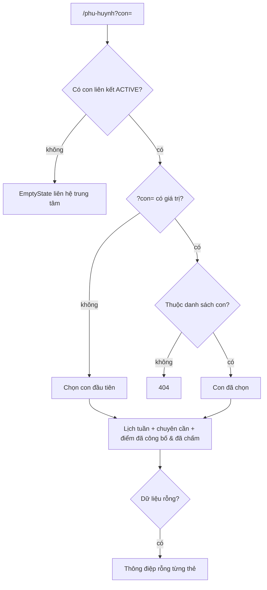

## 12. Hủy/dời buổi (UC-015)

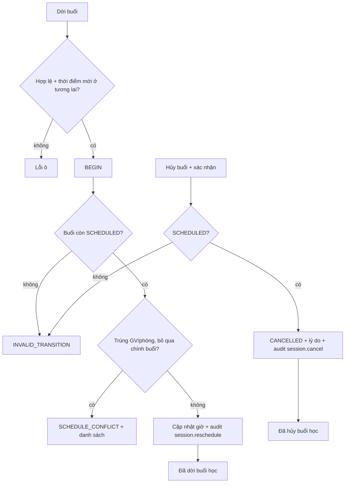
