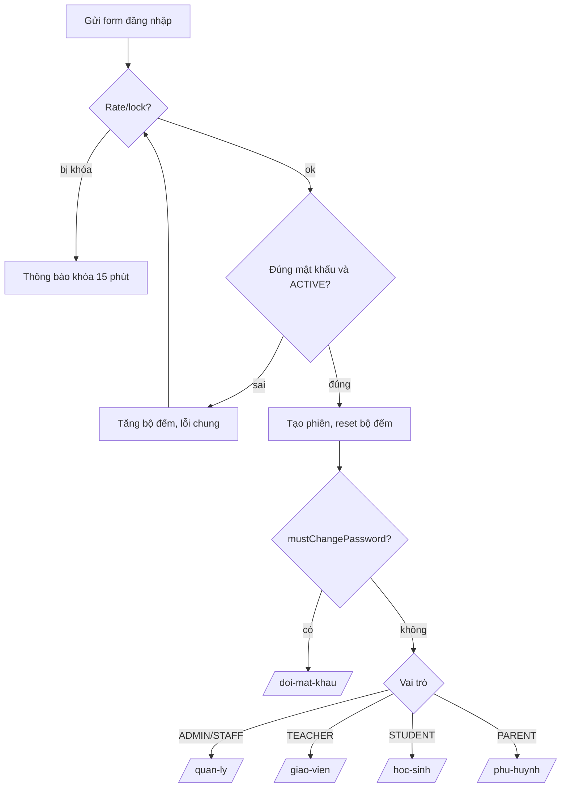
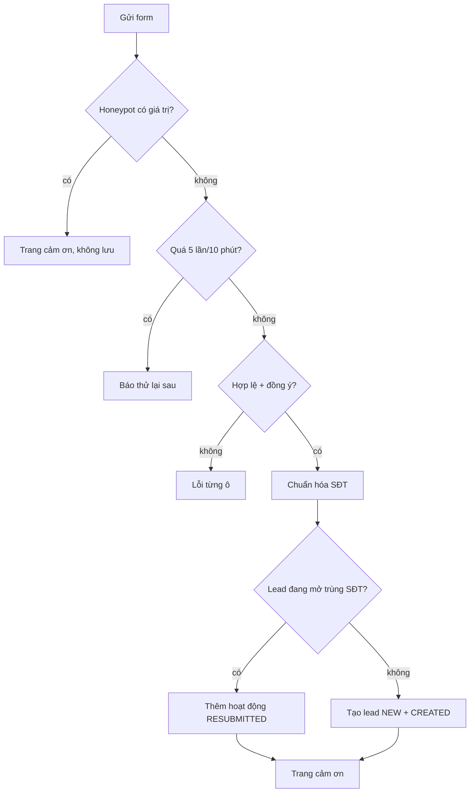
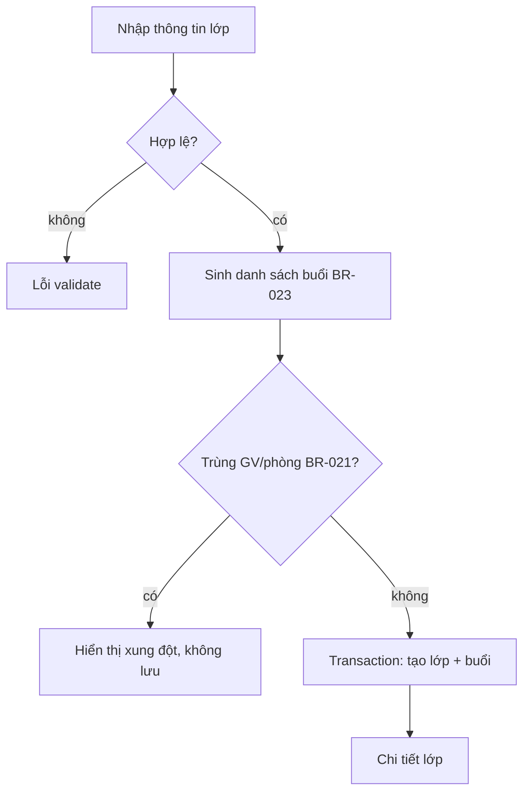
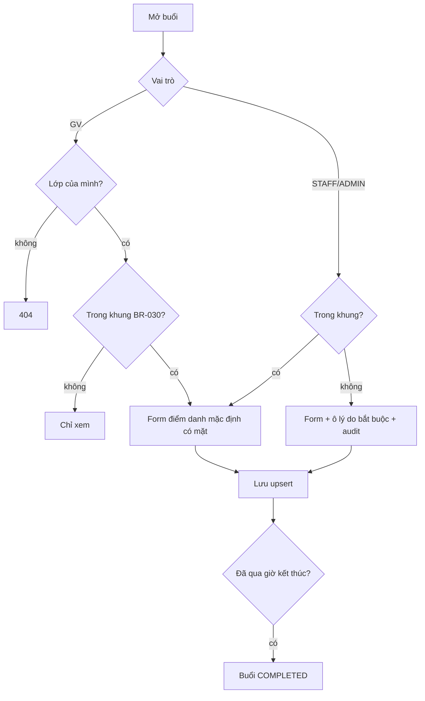

# 07 — Sitemap, luồng người dùng và sơ đồ logic

Trạng thái: **đã hiện thực** trong code Pha 1 (2026-10-21); chưa kiểm tra thủ công trên DB thật.

## 1. Sitemap

```text
Công khai
  /                          Trang chủ (FR-001)
  /khoa-hoc                  Danh mục (?mon=&khoi=) (FR-002)
  /khoa-hoc/[slug]           Chi tiết khóa (FR-003)
  /dang-ky-hoc-thu           Form học thử (?khoa=slug) (FR-004)
  /dang-ky-hoc-thu/cam-on
  /dang-nhap                 (FR-010)
Mọi vai trò đã đăng nhập
  /doi-mat-khau              (FR-012)
Staff/Admin  /quan-ly
  /quan-ly                   Tổng quan (FR-034)
  /quan-ly/lead, /quan-ly/lead/[id]                  (FR-006..009)
  /quan-ly/lop, /quan-ly/lop/moi, /quan-ly/lop/[id]  (FR-017..021)
  /quan-ly/buoi/[id]         Điểm danh ngoài khung (FR-024)
  /quan-ly/hoc-vien          Học sinh + phụ huynh, liên kết (FR-014)
  /quan-ly/khoa-hoc, /quan-ly/khoa-hoc/[id], /quan-ly/mon-hoc, /quan-ly/phong   (Admin, FR-015, FR-016)
  /quan-ly/nguoi-dung, /quan-ly/nguoi-dung/[id]         (Admin, FR-013)
  /quan-ly/nhat-ky           (Admin, FR-035)
Giáo viên  /giao-vien
  /giao-vien                 Tổng quan: buổi hôm nay, bài chờ chấm
  /giao-vien/lich            Lịch tuần (FR-022)
  /giao-vien/lop             Danh sách lớp mình dạy
  /giao-vien/lop/[id]        Học sinh, buổi, bài tập, bảng điểm (FR-033)
  /giao-vien/buoi/[id]       Điểm danh (FR-023)
  /giao-vien/bai-tap/moi?lop=, /giao-vien/bai-tap/[id]   Soạn bài (FR-027, FR-028)
  /giao-vien/bai-tap/[id]/bai-nop, /giao-vien/bai-nop/[id] Chấm (FR-031, FR-032)
Học sinh  /hoc-sinh
  /hoc-sinh                  Tổng quan
  /hoc-sinh/lich, /hoc-sinh/bai-tap, /hoc-sinh/bai-tap/[id]
  /hoc-sinh/ket-qua          Điểm đã công bố + chuyên cần (FR-025, FR-033)
Phụ huynh  /phu-huynh
  /phu-huynh                 Chọn con (?con=) → lịch, chuyên cần, điểm (FR-034)
```

## 2. Điều hướng sau đăng nhập



## 3. Đăng ký học thử (UC-001)



## 4. Mở lớp (UC-005)



## 5. Làm bài → chấm → công bố (UC-009, UC-010)

```mermaid
sequenceDiagram
  actor HS as Học sinh
  participant S as Server
  actor GV as Giáo viên
  HS->>S: Mở bài (cần ghi danh ACTIVE, bài PUBLISHED)
  S-->>HS: Câu hỏi KHÔNG kèm đáp án; tạo submission IN_PROGRESS
  HS->>S: Lưu nháp (upsert answers)
  HS->>S: Nộp
  alt đã nộp / quá hạn không cho muộn
    S-->>HS: Từ chối
  else hợp lệ
    S->>S: Tự chấm MCQ/SHORT, status SUBMITTED hoặc GRADED
    S-->>HS: "Đã nộp, chờ công bố"
  end
  GV->>S: Chấm tự luận, nhận xét
  GV->>S: Công bố kết quả
  HS->>S: Xem kết quả
  S-->>HS: Điểm + đáp án + nhận xét
```

## 6. Điểm danh (UC-007)


