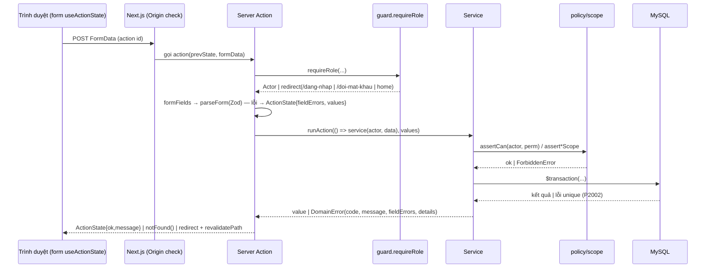

# 09b — Kiến trúc thành phần (C4 level 3) và quy tắc phụ thuộc

| Mục | Giá trị |
|---|---|
| Phiên bản | 3.1 (2026-10-21) — module map đầy đủ, quy tắc phụ thuộc, vòng đời request, failure modes, observability |
| Trạng thái | Đã xác minh với code |
| Owner | Trợ lý (Architect/Tech Lead) |

Xem thêm: [system-context.md](system-context.md) · [ADR](adr/) · [20 FE guide](../20-frontend-guide.md) · [21 BE guide](../21-backend-guide.md).

## 1. Cấu trúc mã nguồn

```text
prisma/
  schema.prisma                 nguồn sự thật dữ liệu (18 bảng)
  migrations/<ts>_init/         migration SQL (sinh offline)
  seed.ts                       dữ liệu demo GIẢ, chạy lại được
prisma.config.ts                cấu hình Prisma CLI (schema, seed), nạp .env
scripts/check-db.mjs            chạy trước `pnpm dev`: báo rõ khi DB chưa có schema v3
src/
  app/                          ROUTING + TRÌNH BÀY (Server Components mặc định)
    layout.tsx, globals.css     font, metadata gốc, design tokens
    (public)/...                trang công khai (PublicShell) + /dang-nhap
    doi-mat-khau/
    quan-ly/ giao-vien/ hoc-sinh/ phu-huynh/   khu theo vai trò (AppShell)
      layout.tsx                requireRole + nav
      **/page.tsx               requireRole lần nữa + gọi service đọc
      loading.tsx               PageSkeleton
    not-found.tsx, error.tsx
  components/
    ui/                         primitive dùng chung, KHÔNG truy cập DB, không import server
    forms/                      ConfigForm, CreateUserForm, ResetPasswordForm, CredentialsNotice, course-fields
    layout/                     PublicShell, AppShell, nav-config, nav-links, Flash
    catalog/ attendance/ assessment/ schedule/ learner/   component theo nghiệp vụ
  server/                       NGHIỆP VỤ (chỉ chạy server)
    db.ts                       Prisma singleton + type Tx
    errors.ts                   DomainError, ForbiddenError, ActionState
    validation.ts               Zod → fieldErrors
    action.ts                   runAction, parseForm, formFields, formIds
    page.ts                     orNotFound (ForbiddenError → 404 trong page)
    request.ts                  clientIp()
    auth/                       session, password, rules, policy, scope, guard, actions
    leads/ academic/ attendance/ assessment/ users/ catalog/ audit/ rate-limit/
      rules.ts                  hàm thuần (unit test)
      schemas.ts                Zod schema dùng chung (nếu có)
      service.ts (+ phụ)        hàm (actor, input) → assertCan/scope → Prisma
      actions.ts                "use server": requireRole → parse → runAction → revalidate/redirect
  lib/                          tiện ích thuần không phụ thuộc server: phone, time, schedule, grading, format, labels
```

## 2. Module map (domain → file → trách nhiệm)

| Module | File chính | Trách nhiệm | Phụ thuộc | FR |
|---|---|---|---|---|
| auth | `session.ts`, `password.ts`, `rules.ts`, `policy.ts`, `scope.ts`, `guard.ts`, `actions.ts` | Phiên DB, Argon2id, khóa tạm, ma trận quyền, phạm vi, cổng trang, đăng nhập/xuất/đổi MK | db, rate-limit, lib/phone | FR-010..012, NFR-001 |
| leads | `rules.ts`, `schemas.ts`, `service.ts`, `actions.ts` | Form học thử, lead, máy trạng thái, chuyển học viên | academic/enrollment, users/credentials, audit, rate-limit | FR-004..009 |
| catalog | `public.ts`, `admin.ts`, `actions.ts` | Đọc công khai; quản trị môn/khóa/phòng | db | FR-001..003, 015, 016 |
| academic | `rules.ts`, `enrollment.ts`, `service.ts`, `actions.ts` | Lớp, buổi, trùng lịch, ghi danh, lịch tuần | lib/schedule, lib/time, audit | FR-017..022 |
| attendance | `rules.ts`, `service.ts`, `actions.ts` | Điểm danh, khung, override, chuyên cần, cảnh báo | auth/scope, audit | FR-023..026 |
| assessment | `service.ts`, `actions.ts` (+ `lib/grading.ts`) | Bài tập, câu hỏi, làm/nộp, chấm, công bố, bảng điểm | auth/scope, audit | FR-027..033 |
| users | `rules.ts`, `credentials.ts`, `service.ts`, `actions.ts` | Tài khoản, mã HS, mật khẩu tạm, liên kết PH | auth, audit | FR-013, 014 |
| audit | `log.ts`, `queries.ts` | Ghi append-only, xem | db | FR-035 |
| rate-limit | `rules.ts`, `limiter.ts` | Cửa sổ cố định theo khóa trong DB | db | FR-005, 011 |

## 3. Quy tắc phụ thuộc (bắt buộc)

```mermaid
flowchart LR
  app["src/app (pages, layouts)"] --> comp["src/components"]
  app --> server["src/server (services, actions)"]
  comp -- "chỉ import actions + type" --> server
  server --> lib["src/lib (thuần)"]
  comp --> lib
  server --> prisma["Prisma"]
  lib -.x.- prisma
  comp -.x.- prisma
```

1. `src/lib/**` và `*/rules.ts`: **thuần** — không import Prisma client runtime, `next/*`, React; chỉ type từ `@prisma/client`. Có unit test.
2. `src/components/ui/**`: không import `src/server/**` (trừ type `ActionState`), không truy cập DB.
3. Component client chỉ gọi Server Action đã export từ `actions.ts`; không gọi service trực tiếp.
4. Page (Server Component) đọc dữ liệu **chỉ qua service** nhận `actor` (trừ dữ liệu công khai `catalog/public.ts`).
5. Mọi service đọc/ghi dữ liệu nội bộ bắt đầu bằng `assertCan` và/hoặc kiểm tra phạm vi.
6. `redirect()` gọi **sau** `runAction`, không trong service (redirect là exception đặc biệt của Next).
7. Chuyển múi giờ chỉ qua `src/lib/time.ts`.
8. Audit chỉ qua `writeAudit` (append-only), nhận `tx` khi trong transaction.

## 4. Vòng đời một thao tác ghi



Đọc (Server Component): `requireRole` → `orNotFound(service(actor, id))` → render. `ForbiddenError` → `notFound()`.

## 5. Quy ước xuyên suốt

| Chủ đề | Quy ước |
|---|---|
| Lỗi | `DomainError(code, messageVi, fieldErrors?, details?)` → form; `ForbiddenError` → 404 (ADR-004); lỗi khác → `error.tsx` |
| Kết quả action | `ActionState { ok, message?, fieldErrors?, details?, values? }`; `values` không chứa mật khẩu |
| ID | cuid (`String @id`); input id giới hạn 1–40 ký tự |
| Thời gian | DB `DATETIME(3)` UTC; `Class.startTime/endTime` "HH:mm" giờ VN; `startDate` `DATE` |
| Tiền | `Int` đồng (không thập phân) |
| Điểm | `Float`, làm tròn 2 chữ số ở logic (DECISION-D10) |
| JSON | `outcomes`, `syllabus`, `options`, `acceptedAnswers`, `utm`, `detail` — đọc qua hàm kiểm kiểu (`asStringArray`, `jsonStrings`) |
| Cache | Trang động (`force-dynamic` cho công khai); sau ghi gọi `revalidatePath` đúng đường dẫn |
| Đồng thời | docs/06 §3 |

## 6. Failure modes

| Tình huống | Hành vi | Bằng chứng |
|---|---|---|
| MySQL không kết nối được | Trang `error.tsx` chung, không lộ stack; `pnpm dev` chặn trước bằng `check-db` | Code; chưa thử thực tế |
| DB chưa migrate (schema v2) | `check-db` in hướng dẫn `pnpm db:reset` | Code |
| Hai GV điểm danh cùng lúc | Upsert theo unique, bản ghi sau thắng | Thiết kế |
| Hai Staff ghi danh chỗ cuối | `SELECT … FOR UPDATE` dòng lớp trong transaction | Code; integration test chưa chạy |
| HS bấm nộp hai lần | `updateMany where status=IN_PROGRESS` → lần hai `ALREADY_SUBMITTED` | Code |
| Va chạm mã HS | Thử lại ≤ 3 lần | Unit (`credentials.test.ts`) |
| Request RSC thẳng tới trang con (bỏ qua layout) | Trang tự `requireRole` | Review |
| Server Action gọi trực tiếp bằng công cụ | Action tự `requireRole` + service kiểm phạm vi | Review |
| Proxy không ghi đè `X-Forwarded-For` | Rate limit có thể bị né (RISK-009) | Ghi nhận |

## 7. Observability (Pha 1)

- Log: stdout của Next.js (lỗi không bắt). Không log input form, mật khẩu, token, dữ liệu học sinh (NFR-006).
- Truy vết nghiệp vụ: `audit_logs` (FR-035), `lead_activities`.
- Chưa có metrics/alert/tracing — QUESTION-Q05, P2-22.

## 8. ADR

| ADR | Quyết định | Trạng thái |
|---|---|---|
| [ADR-001](adr/ADR-001-stack-selection.md) | Next.js 15 fullstack + Prisma 6 + MySQL 8 | Accepted |
| [ADR-002](adr/ADR-002-db-sessions.md) | Phiên lưu trong DB, cookie token ngẫu nhiên | Accepted |
| [ADR-003](adr/ADR-003-server-actions-as-api.md) | Server Actions là API nội bộ, chưa có REST | Accepted |
| [ADR-004](adr/ADR-004-not-found-for-scope.md) | Sai phạm vi trả 404, sai vai trò chuyển hướng | Accepted |
