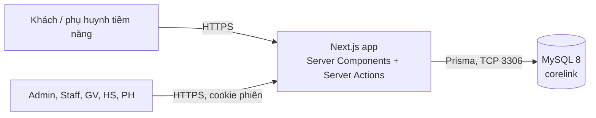
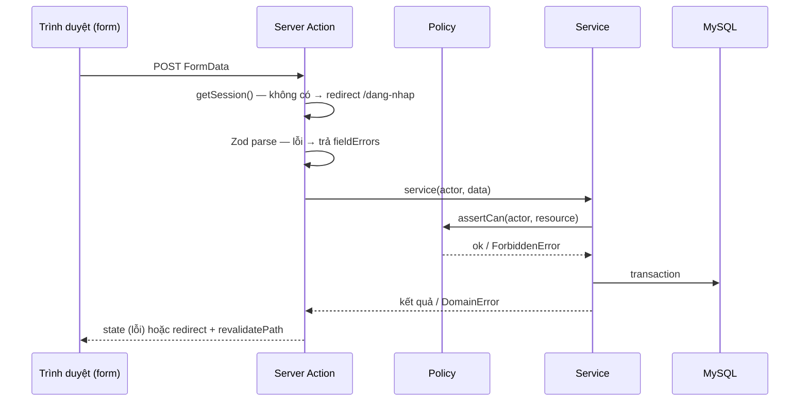

# 09 — Kiến trúc hệ thống

## 1. System context


Ranh giới tin cậy: trình duyệt ↔ server Next.js. Mọi dữ liệu từ trình duyệt (form, query string, params) là không tin cậy và được validate bằng Zod trên server.

## 2. Cấu trúc mã nguồn

```text
prisma/schema.prisma, prisma/migrations/, prisma/seed.ts
src/
  app/
    (public)/...            trang công khai (SSR, metadata SEO)
    dang-nhap/, doi-mat-khau/
    quan-ly/ giao-vien/ hoc-sinh/ phu-huynh/   khu vực theo vai trò; layout VÀ từng trang gọi requireRole()
                            (layout không chặn được request RSC tới trang con nên trang phải tự kiểm tra)
  components/ui/            component dùng chung (không truy cập DB)
  components/<domain>/      component theo nghiệp vụ (forms, attendance, assessment, schedule, learner, catalog, layout)
  server/
    db.ts                   Prisma client singleton
    errors.ts, validation.ts  DomainError/ForbiddenError, ActionState; Zod → fieldErrors
    auth/                   session.ts, password.ts, rules.ts (logic thuần), policy.ts (quyền theo vai trò),
                            guard.ts (requireActor/requireRole), actions.ts
    action.ts               runAction / parseForm / formFields — khung chung của Server Action
    page.ts                 orNotFound() — ForbiddenError → 404 trong Server Component
    auth/scope.ts           phạm vi dữ liệu (lớp của GV, con của PH, lớp có ghi danh của HS)
    leads/ academic/ attendance/ assessment/ users/ catalog/ audit/ rate-limit/
      *.ts                  service: hàm nhận (actor, input) → kiểm quyền → Prisma
      actions.ts            "use server": parse FormData bằng Zod → gọi service → revalidate/redirect
      *.test.ts             Vitest cho logic thuần
  lib/                      tiện ích thuần: phone.ts, time.ts, grading.ts, schedule.ts, format.ts
```

## 3. Luồng một thao tác ghi



## 4. Quy ước

- Lỗi nghiệp vụ ném `DomainError(code, message)`; action chuyển thành thông báo tiếng Việt cho form. Lỗi quyền ném `ForbiddenError` → `notFound()`.
- Thời gian: DB `DATETIME(3)` UTC; chuyển đổi múi giờ chỉ ở `src/lib/time.ts`.
- Không gọi Prisma trực tiếp từ component client. Component server đọc dữ liệu qua hàm service có kiểm tra quyền.

## 5. Failure modes

| Tình huống | Hành vi |
|---|---|
| MySQL không kết nối được | Trang `error.tsx` chung, không lộ stack trace |
| Hai giáo viên điểm danh cùng lúc | Upsert theo unique, bản ghi sau thắng |
| Hai Staff ghi danh chỗ cuối cùng | Kiểm tra sĩ số trong transaction; isolation mặc định của MySQL (REPEATABLE READ) + `SELECT … FOR UPDATE` trên dòng lớp |
| Học sinh bấm nộp hai lần | `updateMany where status=IN_PROGRESS`, lần hai nhận 0 dòng → báo đã nộp |

## 6. ADR

- [ADR-001 Stack](adr/ADR-001-stack-selection.md)
