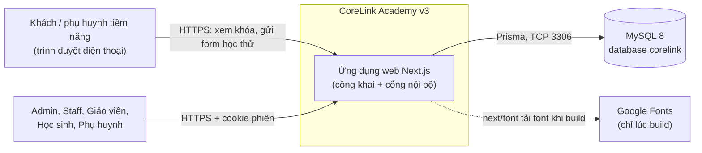
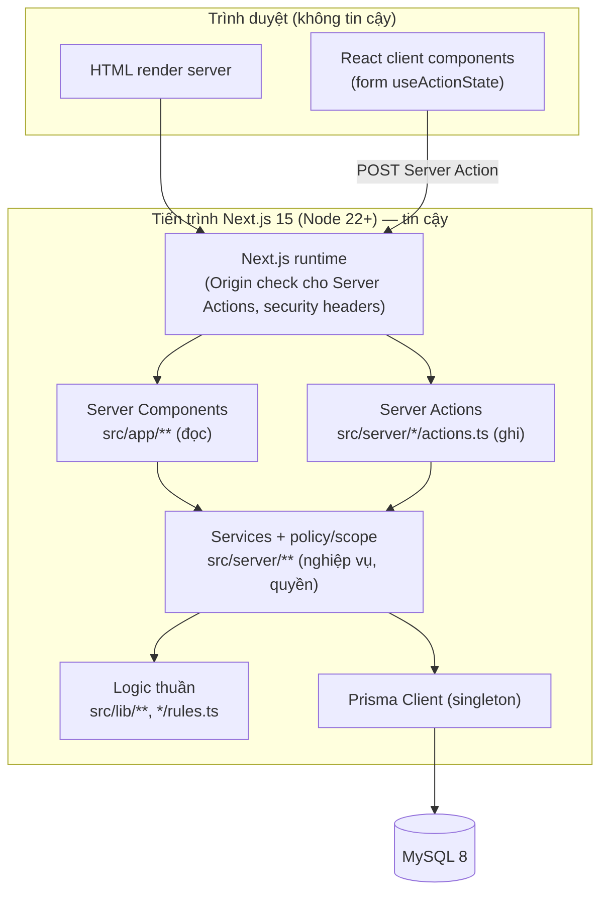
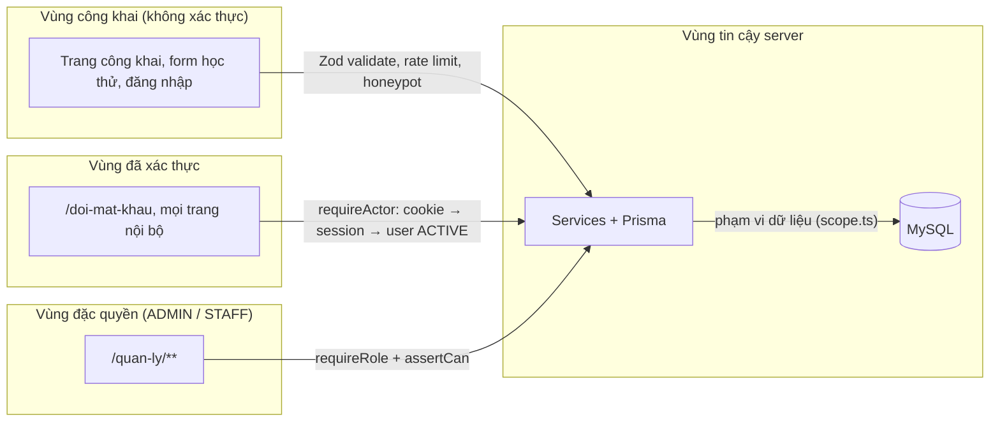
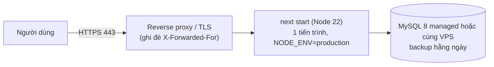

# 09a — System Context, Containers và Trust Boundaries

| Mục | Giá trị |
|---|---|
| Phiên bản | 1.0 (2026-10-21) |
| Trạng thái | Context/container: **đã xác minh với code**. Deployment production: **proposed** (hosting TBD — QUESTION-Q04) |
| Owner | Trợ lý (Solution Architect) · Phê duyệt: chủ dự án |

## 1. System context (C4 level 1)

| Hệ thống / actor | Trách nhiệm | Không làm |
|---|---|---|
| CoreLink web | Hiển thị công khai, xác thực, phân quyền, nghiệp vụ, ghi DB | Gửi email/SMS, thanh toán, lưu file |
| MySQL 8 | Nguồn sự thật duy nhất (18 bảng), transaction, unique/FK | Logic nghiệp vụ (không trigger/stored procedure) |
| Google Fonts | Cung cấp font tại thời điểm build (self-host trong bundle) | Không gọi lúc chạy |
| Kênh ngoài hệ thống | Staff gửi mật khẩu tạm cho phụ huynh (điện thoại/Zalo) | — |

Không có tích hợp bên thứ ba lúc chạy ở Pha 1 → không có webhook, API key, quota.

## 2. Containers (C4 level 2)

| Container | Công nghệ | Trách nhiệm | Ghi chú |
|---|---|---|---|
| Web app | Next.js 15 App Router, React 19, TypeScript strict, Tailwind 4 | Toàn bộ UI + API nội bộ (Server Actions) | Một tiến trình (ADR-001) |
| Database | MySQL 8, utf8mb4, Prisma Migrate | Dữ liệu, phiên, rate limit, audit | Không Redis (ADR-001, ADR-002) |

## 3. Trust boundaries và luồng dữ liệu

| Ranh giới | Kiểm soát | Tài liệu |
|---|---|---|
| Trình duyệt → server | Mọi input (FormData, query, params) là không tin cậy → Zod; độ dài giới hạn; id ≤ 40 ký tự | docs/11, 12 |
| Chưa đăng nhập → đã đăng nhập | Cookie httpOnly, sha256 token trong DB, hết hạn 7 ngày, user ACTIVE | ADR-002 |
| Vai trò thường → đặc quyền | `requireRole` ở layout **và** từng trang/action; `assertCan` trong service | docs/03 |
| Đúng vai trò → đúng bản ghi | `scope.ts`, kiểm tra trong service; sai → 404 | ADR-004 |
| Server → DB | Một user DB ứng dụng; least privilege khi production (TBD) | docs/14 |

**Dữ liệu nhạy cảm đi qua:** SĐT/email phụ huynh (form công khai → leads), dữ liệu học sinh vị thành niên (điểm, chuyên cần), mật khẩu (chỉ trong request đăng nhập/đổi mật khẩu, băm Argon2id ngay), mật khẩu tạm (chỉ trong response một lần).

## 4. Deployment view

### 4.1 Hiện tại (đã xác minh)
Máy dev Windows: `pnpm dev` (Next.js dev server :3000) + MySQL 8 local :3306, database `corelink`. Chưa có staging/production.

### 4.2 Đề xuất production (proposed — chờ QUESTION-Q04)

Phương án hosting được so sánh khi chủ dự án chọn (VPS một máy; Vercel + MySQL cloud). Ràng buộc: rate limit theo IP cần proxy đáng tin ghi đè `X-Forwarded-For` (RISK-009); cookie `Secure` bật khi `NODE_ENV=production`.

## 5. Quality attributes và giả định quy mô

| Thuộc tính | Mục tiêu | Cách đạt |
|---|---|---|
| Bảo mật | Không IDOR, không lộ đáp án | Policy server-side mọi đường (docs/03, 12) |
| Toàn vẹn | Không nửa vời khi chuyển lead/ghi danh/nộp bài | Transaction, unique, `FOR UPDATE`, `updateMany` có điều kiện |
| Hiệu năng | NFR-009 ≤ 1,5 s p95 trang nội bộ | Index theo truy vấn (docs/10); quy mô < 500 HS (ASSUMPTION-A06) |
| Bảo trì | Một developer | Một app, logic thuần tách riêng có unit test (NFR-012) |
| Khả dụng | Chưa có SLO | Pha 1 chưa production |

## 6. Failure modes (tổng quan; chi tiết docs/09 component §6)

MySQL mất kết nối → trang lỗi chung; `pnpm dev` dừng sớm với hướng dẫn (`scripts/check-db.mjs`). Không có phụ thuộc ngoài lúc chạy nên không có lỗi tích hợp.
