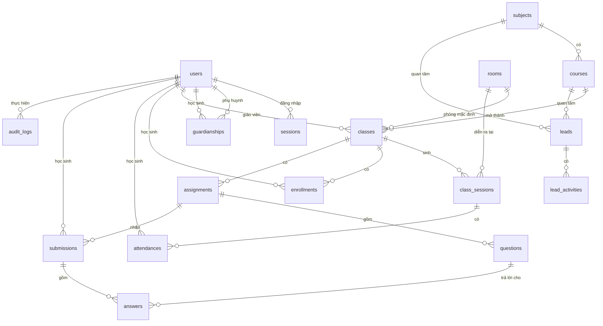

# 10 — Database và ERD

Nguồn sự thật: [`prisma/schema.prisma`](../prisma/schema.prisma). Migration: `prisma/migrations/`. MySQL 8, `utf8mb4`, mọi `DATETIME` là UTC.

## 1. ERD

## 2. Bảng (ENT)

| ID | Bảng | Mục đích | Ràng buộc chính |
|---|---|---|---|
| ENT-001 | `users` | Mọi tài khoản, 1 vai trò | unique `email`, `phone`, `studentCode` |
| ENT-002 | `sessions` | Phiên đăng nhập; `id` = sha256(token) | xóa theo user (cascade) |
| ENT-003 | `guardianships` | Liên kết phụ huynh–học sinh | PK `(parentId, studentId)`; tối đa 4/HS kiểm tra ở service (BR-008) |
| ENT-004 | `subjects` | Môn học | unique `slug` |
| ENT-005 | `courses` | Khóa học mẫu | unique `slug`; `outcomes`, `syllabus` là JSON |
| ENT-006 | `rooms` | Phòng học | unique `name` |
| ENT-007 | `classes` | Lớp mở | unique `code`; `weekdays` "1,3,5"; giờ dạng "HH:mm" giờ VN |
| ENT-008 | `class_sessions` | Buổi học | unique `(classId, index)`; index `(teacherId, startsAt)`, `(roomId, startsAt)` cho kiểm tra trùng |
| ENT-009 | `enrollments` | Ghi danh | unique `(classId, studentId)` |
| ENT-010 | `attendances` | Điểm danh | unique `(sessionId, studentId)` |
| ENT-011 | `leads` | Khách tiềm năng | index `phone`, `(status, createdAt)` |
| ENT-012 | `lead_activities` | Lịch sử lead | append-only |
| ENT-013 | `assignments` | Bài tập | `resultsPublishedAt` = cờ công bố |
| ENT-014 | `questions` | Câu hỏi | đáp án (`correctOption`, `acceptedAnswers`) **không bao giờ** gửi cho HS trước công bố |
| ENT-015 | `submissions` | Bài nộp | unique `(assignmentId, studentId)` |
| ENT-016 | `answers` | Câu trả lời | unique `(submissionId, questionId)` |
| ENT-017 | `audit_logs` | Nhật ký | append-only, không có thao tác xóa trong code |
| ENT-018 | `rate_limit_buckets` | Đếm rate limit theo khóa | key = `trial:<ip>` |

## 3. Quy tắc xóa

- Không xóa cứng người dùng trong Pha 1: dùng `status = DISABLED`.
- Khóa học có lớp: không xóa, chỉ `isPublished = false`.
- Xóa lớp chỉ khi chưa có ghi danh (cascade buổi, bài tập).

## 4. Dữ liệu nhạy cảm

`users.phone`, `users.email`, `leads.phone/email/parentName/studentName`, điểm số, chuyên cần. Không log ra console. Seed chỉ dùng dữ liệu giả (SĐT dạng `+8490000xxxx`).

## 5. Migration và seed

- Lần đầu: `pnpm db:migrate` (= `prisma migrate dev`) tạo `prisma/migrations/<ts>_init`.
- Seed: `pnpm db:seed` — môn, khóa, phòng, tài khoản demo (xem `docs/14-deployment-and-operations.md`).
- Production: `prisma migrate deploy`; không bao giờ `migrate reset`.

## 6. Sao lưu

Trước thao tác phá hủy: `mysqldump --single-transaction corelink > backup/corelink-<ngày>.sql` (thư mục `backup/` nằm trong `.gitignore`).
