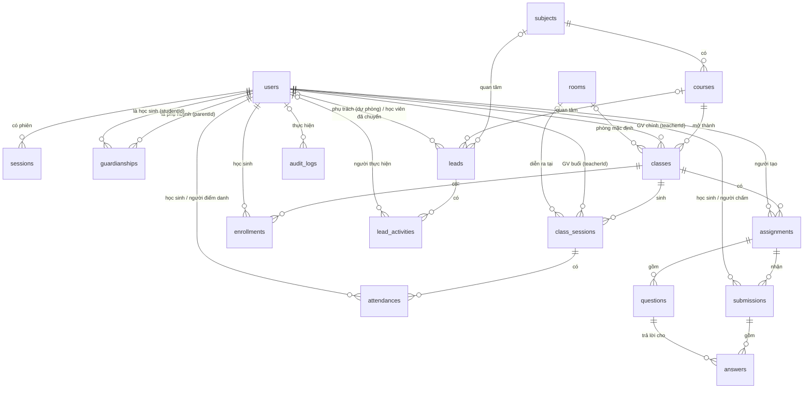

# 10 — Database, ERD và Data Dictionary

| Mục | Giá trị |
|---|---|
| Phiên bản | 3.1 (2026-10-21) — data dictionary theo từng cột, khớp `prisma/migrations/20261021000000_init/migration.sql` |
| Owner | Trợ lý (DBA / Data Modeler) · Phê duyệt: chủ dự án |
| Nguồn sự thật | [`prisma/schema.prisma`](../prisma/schema.prisma) + migration SQL. Tài liệu này mô tả, không thay thế |

## 1. Data architecture assumptions

| Mục | Giá trị |
|---|---|
| DBMS | MySQL 8 (dev: `localhost:3306`, database `corelink`) |
| Charset / collation | `utf8mb4` / `utf8mb4_unicode_ci` (so sánh chuỗi không phân biệt hoa thường — tìm kiếm `contains` cũng vậy) |
| Thời gian | Mọi `DATETIME(3)` là **UTC**; `classes.startDate` kiểu `DATE`; giờ lớp "HH:mm" theo giờ VN |
| Migration tool | Prisma Migrate. Migration hiện có: `20261021000000_init` (sinh offline bằng `prisma migrate diff --from-empty`) — **chưa áp vào `corelink`** (RISK-007) |
| ID | `cuid()` → `VARCHAR(191)`; ngoại lệ `sessions.id` = sha256 hex `VARCHAR(64)`, `rate_limit_buckets.key` |
| Quy mô ước tính | < 500 HS, < 50 lớp đồng thời, ~ 20.000 bản ghi điểm danh/năm (ASSUMPTION-A06) |
| Môi trường | Dev dùng dữ liệu giả từ seed; DB test riêng `corelink_test` cho integration test (chưa được cấp quyền — QUESTION-Q08) |
| Thao tác cấm trên production | `prisma migrate reset`, `db push --force-reset`, DROP bảng |

## 2. ERD

## 3. Bảng (ENT) — tổng quan

| ENT | Bảng | Mục đích | Ước lượng dòng/năm | Sở hữu |
|---|---|---|---|---|
| ENT-001 | `users` | Mọi tài khoản, đúng 1 vai trò | ~ 1.500 | Admin/Staff |
| ENT-002 | `sessions` | Phiên đăng nhập | vài nghìn (cần dọn hết hạn — RISK-010) | Hệ thống |
| ENT-003 | `guardianships` | Liên kết PH–HS | ~ 600 | Staff |
| ENT-004 | `subjects` | Môn | 6 | Admin |
| ENT-005 | `courses` | Khóa học mẫu | < 100 | Admin |
| ENT-006 | `rooms` | Phòng | < 20 | Admin |
| ENT-007 | `classes` | Lớp mở | < 200 | Staff |
| ENT-008 | `class_sessions` | Buổi học | ~ 5.000 | Staff (sinh), GV (trạng thái qua điểm danh) |
| ENT-009 | `enrollments` | Ghi danh | ~ 1.500 | Staff |
| ENT-010 | `attendances` | Điểm danh | ~ 20.000 | GV, Staff |
| ENT-011 | `leads` | Khách tiềm năng | ~ 2.000 | Staff |
| ENT-012 | `lead_activities` | Lịch sử lead (append-only) | ~ 8.000 | Hệ thống/Staff |
| ENT-013 | `assignments` | Bài tập | ~ 1.000 | GV |
| ENT-014 | `questions` | Câu hỏi | ~ 10.000 | GV |
| ENT-015 | `submissions` | Bài nộp | ~ 15.000 | HS, GV |
| ENT-016 | `answers` | Câu trả lời | ~ 150.000 | HS, GV |
| ENT-017 | `audit_logs` | Nhật ký (append-only) | vài nghìn | Hệ thống |
| ENT-018 | `rate_limit_buckets` | Bộ đếm rate limit | ≤ số IP | Hệ thống |

## 4. Data dictionary

Ký hiệu: **PK** khóa chính · **FK→** khóa ngoại (hành vi khi xóa) · **UQ** unique · **IX** index · Nhạy cảm: **PII** dữ liệu cá nhân, **MINOR** dữ liệu học sinh vị thành niên, **SECRET** bí mật.

### ENT-001 `users`
| Cột | Kiểu | Null | Mặc định | Ràng buộc | Ý nghĩa | Nhạy cảm |
|---|---|---|---|---|---|---|
| id | VARCHAR(191) | N | cuid | PK | | |
| email | VARCHAR(191) | Y | | UQ | Đăng nhập; lưu chữ thường | PII |
| phone | VARCHAR(20) | Y | | UQ | Đăng nhập; dạng `+84…` (BR-001) | PII |
| fullName | VARCHAR(120) | N | | | Họ tên | PII/MINOR |
| passwordHash | VARCHAR(255) | N | | | Argon2id | SECRET |
| role | ENUM(ADMIN,STAFF,TEACHER,STUDENT,PARENT) | N | | IX | Một vai trò (D04) | |
| status | ENUM(ACTIVE,DISABLED) | N | ACTIVE | | Khóa thay cho xóa | |
| mustChangePassword | BOOLEAN | N | false | | Bắt đổi mật khẩu tạm | |
| failedLoginCount | INT | N | 0 | | BR-005 | |
| lockedUntil | DATETIME(3) | Y | | | Khóa tạm tới (UTC) | |
| studentCode | VARCHAR(16) | Y | | UQ | `HSyyNNNN` (BR-007), chỉ HS | MINOR |
| gradeLevel | TINYINT | Y | | | Khối 1..12, chỉ HS | MINOR |
| createdAt / updatedAt | DATETIME(3) | N | now / auto | | | |

### ENT-002 `sessions`
| Cột | Kiểu | Null | Mặc định | Ràng buộc | Ý nghĩa | Nhạy cảm |
|---|---|---|---|---|---|---|
| id | VARCHAR(64) | N | | PK | sha256(token) hex — token thật chỉ ở cookie | SECRET (dẫn xuất) |
| userId | VARCHAR(191) | N | | FK→users (CASCADE), IX | | |
| expiresAt | DATETIME(3) | N | | | now + 7 ngày | |
| createdAt | DATETIME(3) | N | now | | | |

### ENT-003 `guardianships`
| Cột | Kiểu | Null | Mặc định | Ràng buộc | Ý nghĩa |
|---|---|---|---|---|---|
| parentId | VARCHAR(191) | N | | PK(parentId, studentId), FK→users (CASCADE) | PH |
| studentId | VARCHAR(191) | N | | FK→users (CASCADE), IX | HS; ≤ 4 PH (BR-008, kiểm ở service + khóa dòng) |
| relation | VARCHAR(40) | N | 'Phụ huynh' | | Chưa có UI sửa (dự phòng) |
| createdAt | DATETIME(3) | N | now | | |

### ENT-004 `subjects`
| Cột | Kiểu | Null | Mặc định | Ràng buộc | Ý nghĩa |
|---|---|---|---|---|---|
| id | VARCHAR(191) | N | cuid | PK | |
| name | VARCHAR(80) | N | | | Tên môn |
| slug | VARCHAR(80) | N | | UQ | `?mon=` |
| description | TEXT | N | | | Mô tả trang chủ |
| sortOrder | INT | N | 0 | | Thứ tự hiển thị |

### ENT-005 `courses`
| Cột | Kiểu | Null | Mặc định | Ràng buộc | Ý nghĩa |
|---|---|---|---|---|---|
| id | VARCHAR(191) | N | cuid | PK | |
| subjectId | VARCHAR(191) | N | | FK→subjects (**RESTRICT**), IX(subjectId, isPublished) | Môn |
| title | VARCHAR(160) | N | | | |
| slug | VARCHAR(160) | N | | UQ | URL công khai |
| summary | VARCHAR(300) | N | | | Thẻ khóa, meta description |
| description | TEXT | N | | | |
| gradeFrom / gradeTo | TINYINT | N | | gradeFrom ≤ gradeTo (kiểm ở action) | Khối áp dụng |
| level | VARCHAR(60) | N | | | Trình độ |
| totalSessions | SMALLINT | N | | 1..500 | Số buổi mẫu |
| sessionMinutes | SMALLINT | N | | 15..300 | |
| tuitionVnd | INT | Y | | 0..1e9 | Học phí tham khảo; null = "Liên hệ" (ASSUMPTION-A03) |
| outcomes | JSON | N | | `string[]` | Mục tiêu |
| syllabus | JSON | N | | `{title, detail}[]` | Lộ trình |
| isPublished | BOOLEAN | N | false | | Hiện công khai |
| isFeatured | BOOLEAN | N | false | | Trang chủ |
| createdAt / updatedAt | DATETIME(3) | N | | | |

### ENT-006 `rooms`
| Cột | Kiểu | Null | Mặc định | Ràng buộc | Ý nghĩa |
|---|---|---|---|---|---|
| id | VARCHAR(191) | N | cuid | PK | |
| name | VARCHAR(60) | N | | UQ | |
| capacity | SMALLINT | N | | 1..500 | BR-024 |

### ENT-007 `classes`
| Cột | Kiểu | Null | Mặc định | Ràng buộc | Ý nghĩa |
|---|---|---|---|---|---|
| id | VARCHAR(191) | N | cuid | PK | |
| code | VARCHAR(30) | N | | UQ | Mã lớp viết hoa |
| courseId | VARCHAR(191) | N | | FK→courses (**RESTRICT**), IX(courseId, status) | |
| teacherId | VARCHAR(191) | N | | FK→users (RESTRICT), IX | GV chính |
| roomId | VARCHAR(191) | Y | | FK→rooms (SET NULL) | |
| startDate | DATE | N | | | Ngày bắt đầu (lịch VN, lưu `YYYY-MM-DD 00:00Z`) |
| weekdays | VARCHAR(20) | N | | "1,3,5" | 1 = Thứ Hai … 7 = Chủ nhật |
| startTime / endTime | CHAR(5) | N | | "HH:mm", end > start | Giờ VN |
| totalSessions | SMALLINT | N | | 1..200 | |
| capacity | SMALLINT | N | | 1..100, ≤ phòng | Sĩ số tối đa |
| status | ENUM(OPEN,IN_PROGRESS,COMPLETED,CANCELLED) | N | OPEN | | 06 §2.2 |
| createdAt / updatedAt | DATETIME(3) | N | | | |

### ENT-008 `class_sessions`
| Cột | Kiểu | Null | Mặc định | Ràng buộc | Ý nghĩa |
|---|---|---|---|---|---|
| id | VARCHAR(191) | N | cuid | PK | |
| classId | VARCHAR(191) | N | | FK→classes (CASCADE); UQ(classId, index) | |
| index | SMALLINT | N | | | Buổi thứ n |
| startsAt / endsAt | DATETIME(3) | N | | IX(startsAt); IX(teacherId, startsAt); IX(roomId, startsAt) | UTC |
| teacherId | VARCHAR(191) | N | | FK→users (RESTRICT) | GV của buổi (dạy thay được) |
| roomId | VARCHAR(191) | Y | | FK→rooms (SET NULL) | |
| status | ENUM(SCHEDULED,COMPLETED,CANCELLED) | N | SCHEDULED | | 06 §2.4 |
| cancelReason | VARCHAR(255) | Y | | | |

### ENT-009 `enrollments`
| Cột | Kiểu | Null | Mặc định | Ràng buộc | Ý nghĩa |
|---|---|---|---|---|---|
| id | VARCHAR(191) | N | cuid | PK | |
| classId | VARCHAR(191) | N | | FK→classes (CASCADE); UQ(classId, studentId) | |
| studentId | VARCHAR(191) | N | | FK→users (RESTRICT); IX(studentId, status) | |
| status | ENUM(ACTIVE,PAUSED,DROPPED,COMPLETED) | N | ACTIVE | | 06 §2.3 |
| enrolledAt | DATETIME(3) | N | now | | Đặt lại khi ghi danh lại |
| updatedAt | DATETIME(3) | N | auto | | |

### ENT-010 `attendances`
| Cột | Kiểu | Null | Mặc định | Ràng buộc | Ý nghĩa | Nhạy cảm |
|---|---|---|---|---|---|---|
| id | VARCHAR(191) | N | cuid | PK | | |
| sessionId | VARCHAR(191) | N | | FK→class_sessions (CASCADE); UQ(sessionId, studentId) | | |
| studentId | VARCHAR(191) | N | | FK→users (RESTRICT), IX | | MINOR |
| status | ENUM(PRESENT,LATE,ABSENT,EXCUSED) | N | | | | MINOR |
| note | VARCHAR(255) | Y | | | Ghi chú GV | MINOR |
| markedById | VARCHAR(191) | N | | FK→users (RESTRICT) | Người lưu gần nhất | |
| markedAt | DATETIME(3) | N | now | | | |

### ENT-011 `leads`
| Cột | Kiểu | Null | Mặc định | Ràng buộc | Ý nghĩa | Nhạy cảm |
|---|---|---|---|---|---|---|
| id | VARCHAR(191) | N | cuid | PK | | |
| parentName | VARCHAR(120) | N | | | | PII |
| phone | VARCHAR(20) | N | | IX | `+84…` | PII |
| email | VARCHAR(191) | Y | | | | PII |
| studentName | VARCHAR(120) | N | | | | MINOR |
| gradeLevel | TINYINT | Y | | | | MINOR |
| subjectId | VARCHAR(191) | Y | | FK→subjects (SET NULL) | Môn quan tâm | |
| courseId | VARCHAR(191) | Y | | FK→courses (SET NULL) | Khóa quan tâm | |
| note | TEXT | Y | | | Ghi chú phụ huynh | PII |
| source | VARCHAR(40) | N | 'web_form' | BR-012 | `web_form`, `phone`, `walk_in`, `referral`, `other` | |
| utm | JSON | Y | | | Dự phòng (chưa ghi) | |
| status | ENUM(NEW,CONTACTED,TRIAL_SCHEDULED,TRIAL_DONE,ENROLLED,LOST) | N | NEW | IX(status, createdAt) | BR-010 | |
| lostReason | VARCHAR(255) | Y | | | BR-013 | |
| assignedToId | VARCHAR(191) | Y | | FK→users (SET NULL) | **Dự phòng Pha 2** (P2-15), không FR nào dùng | |
| convertedStudentId | VARCHAR(191) | Y | | FK→users (SET NULL) | HS sau chuyển | |
| createdAt / updatedAt | DATETIME(3) | N | | | updatedAt đổi khi có hoạt động | |

### ENT-012 `lead_activities`
| Cột | Kiểu | Null | Mặc định | Ràng buộc | Ý nghĩa |
|---|---|---|---|---|---|
| id | VARCHAR(191) | N | cuid | PK | |
| leadId | VARCHAR(191) | N | | FK→leads (CASCADE), IX(leadId, createdAt) | |
| actorId | VARCHAR(191) | Y | | FK→users (SET NULL) | null = hệ thống/form công khai |
| type | ENUM(CREATED,RESUBMITTED,NOTE,STATUS_CHANGE,CONVERTED) | N | | | |
| content | TEXT | N | | | Có thể chứa PII từ form |
| createdAt | DATETIME(3) | N | now | | |

### ENT-013 `assignments`
| Cột | Kiểu | Null | Mặc định | Ràng buộc | Ý nghĩa |
|---|---|---|---|---|---|
| id | VARCHAR(191) | N | cuid | PK | |
| classId | VARCHAR(191) | N | | FK→classes (CASCADE), IX(classId, status) | |
| createdById | VARCHAR(191) | N | | FK→users (RESTRICT) | GV tạo |
| title | VARCHAR(200) | N | | | |
| instructions | TEXT | N | | ≤ 5000 (action) | |
| dueAt | DATETIME(3) | N | | | UTC |
| allowLate | BOOLEAN | N | false | | BR-044 |
| status | ENUM(DRAFT,PUBLISHED,CLOSED) | N | DRAFT | | BR-049 |
| resultsPublishedAt | DATETIME(3) | Y | | | Cờ công bố (BR-046) |
| createdAt / updatedAt | DATETIME(3) | N | | | |

### ENT-014 `questions`
| Cột | Kiểu | Null | Mặc định | Ràng buộc | Ý nghĩa | Nhạy cảm |
|---|---|---|---|---|---|---|
| id | VARCHAR(191) | N | cuid | PK | | |
| assignmentId | VARCHAR(191) | N | | FK→assignments (CASCADE), IX(assignmentId, order) | | |
| order | SMALLINT | N | | | 1..n, đánh lại khi xóa | |
| type | ENUM(MCQ,SHORT,ESSAY) | N | | | | |
| prompt | TEXT | N | | ≤ 5000 | | |
| options | JSON | Y | | `string[]` 2–6 (MCQ) | | |
| correctOption | TINYINT | Y | | 0-based (MCQ) | Đáp án | **Không gửi HS trước công bố** |
| acceptedAnswers | JSON | Y | | `string[]` ≥ 1 (SHORT) | Đáp án | **Không gửi HS trước công bố** |
| points | DOUBLE | N | | 0,25..100 bước 0,25 | | |

### ENT-015 `submissions`
| Cột | Kiểu | Null | Mặc định | Ràng buộc | Ý nghĩa | Nhạy cảm |
|---|---|---|---|---|---|---|
| id | VARCHAR(191) | N | cuid | PK | | |
| assignmentId | VARCHAR(191) | N | | FK→assignments (CASCADE); UQ(assignmentId, studentId) | | |
| studentId | VARCHAR(191) | N | | FK→users (RESTRICT), IX | | MINOR |
| status | ENUM(IN_PROGRESS,SUBMITTED,GRADED) | N | IN_PROGRESS | | 06 §2.6 | |
| startedAt | DATETIME(3) | N | now | | Lần mở đầu | |
| submittedAt | DATETIME(3) | Y | | | | |
| isLate | BOOLEAN | N | false | | | |
| score | DOUBLE | Y | | | BR-043; null khi chưa chấm | MINOR |
| teacherComment | TEXT | Y | | | | MINOR |
| gradedAt | DATETIME(3) | Y | | | | |
| gradedById | VARCHAR(191) | Y | | FK→users (SET NULL) | | |

### ENT-016 `answers`
| Cột | Kiểu | Null | Mặc định | Ràng buộc | Ý nghĩa | Nhạy cảm |
|---|---|---|---|---|---|---|
| id | VARCHAR(191) | N | cuid | PK | | |
| submissionId | VARCHAR(191) | N | | FK→submissions (CASCADE); UQ(submissionId, questionId) | | |
| questionId | VARCHAR(191) | N | | FK→questions (CASCADE) | | |
| response | TEXT | Y | | ≤ 500 (MCQ/SHORT), ≤ 20.000 (ESSAY) | MCQ: chỉ số dạng chuỗi | MINOR |
| autoPoints | DOUBLE | Y | | | null với tự luận | MINOR |
| teacherPoints | DOUBLE | Y | | BR-042 | Ghi đè autoPoints | MINOR |
| feedback | TEXT | Y | | ≤ 2000 | | MINOR |

### ENT-017 `audit_logs`
| Cột | Kiểu | Null | Mặc định | Ràng buộc | Ý nghĩa |
|---|---|---|---|---|---|
| id | VARCHAR(191) | N | cuid | PK | |
| actorId | VARCHAR(191) | Y | | FK→users (SET NULL) | |
| action | VARCHAR(60) | N | | | `lead.convert`, `user.create`, `user.role_change`, `user.disable`, `user.enable`, `user.reset_password`, `attendance.override`, `grade.update_after_publish`, `session.reschedule`, `session.cancel`, `class.delete`, `course.delete`, `subject.delete`, `room.delete`, `guardian.link`, `guardian.unlink` |
| entity | VARCHAR(40) | N | | IX(entity, entityId) | Tên model (`Lead`, `User`, `ClassSession`, `Submission`) |
| entityId | VARCHAR(40) | N | | | |
| detail | JSON | Y | | | before/after, lý do — **không** chứa mật khẩu/token |
| createdAt | DATETIME(3) | N | now | IX; IX(action, createdAt) | |

### ENT-018 `rate_limit_buckets`
| Cột | Kiểu | Null | Mặc định | Ràng buộc | Ý nghĩa |
|---|---|---|---|---|---|
| key | VARCHAR(120) | N | | PK | `trial:<ip>`, `login:<ip>` |
| count | INT | N | | | Số lần trong cửa sổ |
| resetAt | DATETIME(3) | N | | IX | Hết cửa sổ; bucket hết hạn > 1 ngày bị xóa khi đăng nhập thành công |

## 5. Constraints and lifecycle

| Chủ đề | Quy tắc |
|---|---|
| Xóa người dùng | Không xóa cứng ở Pha 1 → `status = DISABLED` (FK RESTRICT từ classes, sessions, enrollments, attendances, submissions, assignments chặn xóa nhầm) |
| Xóa khóa | Chỉ khi chưa có lớp (BR-050; FK `classes.courseId` RESTRICT là lớp bảo vệ thứ hai); lead → `courseId = NULL` |
| Xóa môn | Chỉ khi chưa có khóa (BR-050; FK `courses.subjectId` RESTRICT); lead → `subjectId = NULL` (FK SET NULL) |
| Xóa phòng | Chỉ khi không lớp/buổi tham chiếu (kiểm ở service; FK SET NULL nếu bỏ qua) |
| Xóa lớp | Chỉ khi chưa ghi danh (BR-027) → cascade buổi, điểm danh, bài tập, câu hỏi, bài nộp, câu trả lời |
| Append-only | `lead_activities`, `audit_logs`: code không có update/delete |
| Unique bảo vệ bất biến | email, phone, studentCode, slug, room.name, class.code, (classId, index), (classId, studentId), (sessionId, studentId), (assignmentId, studentId), (submissionId, questionId) |
| Kiểm ở service (không có CHECK) | gradeFrom ≤ gradeTo; endTime > startTime; capacity ≤ phòng; ≤ 4 PH; điểm trong khoảng |
| Transaction | Chuyển lead, mở lớp + buổi, ghi danh (FOR UPDATE), liên kết PH (FOR UPDATE), điểm danh (nhiều upsert + audit), nộp bài, chấm + audit, dời buổi + audit, đổi trạng thái lớp + hệ quả |
| Concurrency | docs/06 §3 |

## 5b. Bảng bổ sung v3.2 (FR-036..FR-052)

| Bảng | Mục đích | Ghi chú |
|---|---|---|
| `education_levels`, `subject_levels` | Cấp học, liên kết môn–cấp | 4 cấp khởi tạo trong migration |
| `stored_files`, `file_blobs` | Metadata tệp / nội dung nhị phân (DECISION-D24) | Mỗi tệp thuộc đúng một chủ: bài tập, bài nộp, tài liệu (FK cascade) |
| `schedule_requests` | Đề xuất đổi lịch của GV | `RequestStatus`: PENDING/APPROVED/REJECTED/CANCELLED |
| `leave_requests` | Đơn xin nghỉ của PH | Duyệt → `attendances` EXCUSED |
| `documents`, `document_shares` | Giáo trình / tài liệu / giáo án; chia sẻ theo lớp | Gỡ chia sẻ = xóa dòng share |
| `announcements`, `notifications` | Thông báo soạn tay + hộp thư từng người | Fan-out lúc gửi (DECISION-D28) |
| `evaluations` | Đánh giá định kỳ | Duy nhất (lớp, HS, kỳ) |
| `conversations`, `conversation_members`, `messages` | Nhắn tin | CLASS: thành viên suy ra từ lớp; DIRECT: `directKey` duy nhất |

Cột mới: `users` (`memberStatus`, `dateOfBirth`, `address`, `expertise`, `profileNote`), `subjects.isActive`, `rooms` (`isActive`, `note`), `class_sessions` (`isMakeup`, `note`), `assignments` (`acceptsFiles`, `manualMaxScore`). Tất cả có mặc định hoặc cho phép null.

### 5c. Bổ sung v3.3 (DECISION-D30) — migration `20261024090000_chat_files_push_avatar` (chỉ thêm, đã áp 2026-10-22)

| Thay đổi | Mục đích | Ghi chú |
|---|---|---|
| `stored_files.questionId` → `questions` (CASCADE) | Ảnh bài làm câu tự luận | Luôn đi cùng `submissionId`; quyền tải như bài nộp. Index `(submissionId, questionId)` thay index `submissionId` |
| `stored_files.messageId` → `messages` (CASCADE) | Ảnh/tệp đính kèm tin nhắn | Quyền: người xem được cuộc trò chuyện (`canReadMessage`) |
| `users.avatarFileId` (UNIQUE) → `stored_files` (SET NULL) | Ảnh đại diện | Tệp không có chủ sở hữu khác; đổi ảnh xóa tệp cũ cùng transaction |
| `push_subscriptions` (`endpoint` UNIQUE, `p256dh`, `auth`, `userAgent`, `userId` → `users` CASCADE) | Đăng ký Web Push theo thiết bị | Endpoint trả 404/410 khi gửi → xóa; đổi tài khoản trên cùng máy → chuyển `userId` |

### 5d. Bổ sung v3.6 (DECISION-D33) — migration `20261027090000_checklist_v4` (chỉ thêm, đã áp 2026-10-23)

| Thay đổi | Mục đích | Ghi chú |
|---|---|---|
| Enum `AnnouncementAudience` + `USERS` | Thông báo gửi từng người | Người nhận ghi ở `notifications` như các đối tượng khác |
| Enum mới `PracticeDifficulty` (EASY, MEDIUM, HARD) | Mức độ đề luyện | — |
| `assignments.isTest` (bool, mặc định false), `assignments.solution` (text) | Bài kiểm tra / mock test; bài chữa | Bài chữa chỉ trả về HS/PH khi `resultsPublishedAt` có giá trị |
| `submissions.returnedAt`, `submissions.returnNote` | GV yêu cầu nộp lại | Có `returnedAt` → HS nộp được sau hạn |
| `attendances.attitude` (varchar 20) | Thái độ học tập GOOD / NORMAL / NEEDS_WORK | Không bắt buộc |
| `documents.reviewStatus` (RequestStatus), `reviewNote`, `reviewedAt`, `reviewedById` → `users` (SET NULL) | Giáo án gửi duyệt | Chỉ dùng cho `LESSON_PLAN` |
| `users.introDraft`, `introPublished`, `introStatus` (RequestStatus), `introNote` | Hồ sơ giới thiệu GV | Bản công khai chỉ thay khi quản lý duyệt |
| `messages.assignmentId` → `assignments` (SET NULL), `messages.deletedAt`, `deletedById` | Tin "Hỏi bài"; thu hồi / gỡ tin | Tin đã gỡ: xóa nội dung và tệp đính kèm, nội dung cũ vào `audit_logs` (`message.remove`) |
| `conversation_members.mutedAt` | Tạm chặn gửi tin trong nhóm lớp | — |
| `teacher_availabilities` (`teacherId` → `users` CASCADE, `weekday`, `startTime`, `endTime`, `note`) | Lịch rảnh GV | Index `(teacherId, weekday)`; không trùng khung (kiểm ở service) |
| `practice_sets` (`title`, `description`, `topic`, `format`, `difficulty`, `subjectId`/`levelId` SET NULL, `isActive`, `createdById`) | Đề luyện tập | `isActive=false` là nháp |
| `attendances.comment` (VARCHAR 500) | Nhận xét học sinh theo buổi (FR-059) | HS/PH xem; nhập cùng form điểm danh |
| `document_chunks` (`documentId` → `documents` CASCADE, `fileId`, `position`, `text`, `search` không dấu, `tsv` tsvector) | Đoạn văn bản trích từ tệp để AI tra cứu (FR-062) | Index `(documentId, fileId)` + GIN `(tsv)`; ghi `tsv` bằng SQL thô `to_tsvector('simple', search)`. Migration `20261029090000_document_chunks` |
| `courses.syllabus` (JSON, không đổi schema) | Mỗi phần tử `{title, detail, objectives?, knowledge?, examples?}`, số phần tử = `totalSessions` (FR-061) | Kiểm khi lưu khóa |
| `practice_sets.classId` → `classes` (SET NULL), `practice_sets.forStudentId` → `users` (SET NULL) | Đề bổ sung cá nhân (FR-060) | `forStudentId` null = đề chung; có giá trị = chỉ học sinh đó thấy/làm. Index `(classId)`, `(forStudentId)`. Migration `20261028090000_class_tabs` |
| `practice_questions` (`setId` CASCADE, `order`, `type` MCQ/SHORT, `prompt`, `options`, `correctOption`, `acceptedAnswers`, `explanation`, `points`) | Câu hỏi đề luyện | Đáp án + lời giải chỉ trả về sau khi nộp |
| `practice_attempts` (`setId` CASCADE, `studentId` CASCADE, `answers` JSON, `score`, `maxScore`, `correctCount`, `total`, `submittedAt`) | Lượt làm (lịch sử luyện tập) | Index `(studentId, submittedAt)`, `(setId)` |

## 6. Migration and recovery

**Migration `20261023090000_portal_features`** (chỉ thêm bảng/cột + dữ liệu cấp học): đã áp lên Supabase ngày 2026-10-21 cùng `20261022090000_admin_perf_indexes` (PO đồng ý). Rollback: `DROP TABLE` 14 bảng mới + `ALTER TABLE … DROP COLUMN` các cột mới (mất dữ liệu của tính năng mới).

**Migration `20261022090000_admin_perf_indexes`** (chỉ index, không đổi dữ liệu): `users(role, fullName)` thay `users(role)`; `sessions(expiresAt)`; `classes(status, startDate)`, `classes(roomId)`; `leads(subjectId, createdAt)`, `leads(courseId)`; `audit_logs(action, createdAt)`; `rate_limit_buckets(resetAt)`. Chạy: `pnpm db:migrate` (PO chạy). Rollback: `DROP INDEX` từng index + `CREATE INDEX "users_role_idx" ON "users"("role")`.

| Bước | Lệnh (PowerShell, thư mục gốc) | Ghi chú |
|---|---|---|
| Kiểm tra trạng thái | `pnpm db:check` (= `scripts/check-db.mjs` → `prisma migrate status`) | Không phá hủy |
| Lần đầu chuyển từ v2 (dev) | `pnpm db:reset` (= `prisma migrate reset --force`) | **Xóa toàn bộ bảng** rồi áp `init` + seed. Chỉ chủ dự án chạy; đã có backup v2 |
| Áp migration (dev/prod) | `pnpm db:migrate` (= `prisma migrate deploy`) | Không tạo migration mới |
| Tạo migration mới | `pnpm db:migrate:new -- --name <tên>` (= `prisma migrate dev --create-only`) | Review SQL trước khi deploy |
| Seed | `pnpm db:seed` | Dữ liệu giả, chạy lại được (upsert) |
| Production | Chỉ `prisma migrate deploy`; migration chỉ **thêm** (không xóa/đổi cột trong cùng release) để bản cũ còn chạy khi rollback | docs/14 |

**Backup/restore:** trước mọi thao tác phá hủy: `mysqldump --single-transaction corelink > backup/corelink-<ngày>.sql` (`backup/` trong `.gitignore`). Backup v2: `backup/corelink-v2-20261021.sql` (84 bảng). **Chưa từng thử restore** → không coi là bằng chứng phục hồi (RISK-011); kế hoạch thử restore ở docs/14 §6.

**Seed policy:** chỉ dữ liệu giả (SĐT `+8490000xxxx`, email `@demo.corelink.vn`); không chạy seed ở production.

## 7. Security and privacy

| Chủ đề | Quy tắc |
|---|---|
| Least privilege | Dev dùng một user MySQL; production: user ứng dụng chỉ quyền DML trên `corelink`, user migration riêng (TBD — docs/14) |
| Secrets | `DATABASE_URL` chỉ trong `.env`/secret manager; không commit |
| Mã hóa | Mật khẩu Argon2id; token phiên sha256; dữ liệu khác không mã hóa ở mức cột (chấp nhận Pha 1); TLS tới DB khi khác máy (production) |
| PII/MINOR | Không log; không seed dữ liệu thật; truy cập theo docs/03 |
| Retention | Lead LOST: **TBD** (QUESTION-Q03, đề xuất 12 tháng rồi ẩn danh hóa). Audit: TBD (QUESTION-Q11). Phiên hết hạn: dọn định kỳ (RISK-010) |
| Xuất/xóa theo yêu cầu | Chưa có chức năng; Admin làm thủ công qua DB nếu có yêu cầu (ghi QUESTION-Q03) |
