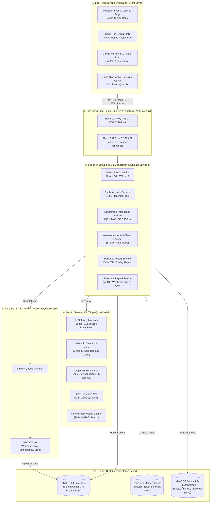

# KIẾN TRÚC HỆ THỐNG TỔNG THỂ (SYSTEM ARCHITECTURE SPECIFICATION)
**Dự án**: CoreLink Academy  
**Tác giả**: Solution Architect & Tech Lead  

---

## 1. Sơ Đồ Kiến Trúc Khối Tổng Thể (System Architecture Topology)

---

## 2. Các Lớp Kiến Trúc Chi Tiết

### 2.1. Frontend Web Client (`apps/web`)
- **Khung phát triển**: Next.js 15 (App Router), React 19, TypeScript.
- **Phong cách giao diện**: Tailwind CSS, Dark mode hiện đại (#0f172a, #2563eb, #60a5fa), bố cục Glassmorphism, chuẩn responsive 5 cấp độ (360px, 390px, 768px, 1024px, 1440px).
- **Hỗ trợ PWA**: Đầy đủ manifest.json, service worker cache offline, icons 192px/512px, có thể cài đặt trực tiếp lên điện thoại iOS/Android.

### 2.2. Backend REST API (`apps/api`)
- **Khung phát triển**: NestJS 11 trên nền tảng Express, TypeScript.
- **Bảo mật mạng**: Helmet bảo vệ HTTP headers, CORS cấu hình chặt chẽ theo `CORS_ORIGIN`, Rate Limiting chống DDoS.
- **Validation Pipe**: Tự động lọc dữ liệu độc hại với `whitelist: true`, `transform: true`, `forbidNonWhitelisted: true`, kết hợp DTOs và Zod schema.
- **Xác thực & Phân quyền**: Passport JWT kép (Access Token 15 phút, Refresh Token 7 ngày lưu trong cơ sở dữ liệu), Guards kiểm tra vai trò RBAC chặt chẽ tại từng Endpoint.

### 2.3. AI Gateway Chuyên Biệt (`packages/ai`)
- **Bộ điều hợp đa mô hình (Provider Adapter Pattern)**: Cho phép chuyển đổi linh hoạt giữa Claude 3.5 Sonnet, Gemini 1.5 Flash và các mô hình nội bộ.
- **Bộ lọc an toàn trẻ em (`AiSafetyFilter`)**: Kiểm duyệt đầu vào và đầu ra, loại bỏ các nội dung bạo lực, nhạy cảm hoặc không phù hợp với lứa tuổi học sinh.
- **Bộ kiểm soát chi phí (`AiBudgetGuard`)**: Giám sát thời gian thực chi phí token gọi API, tự động kích hoạt chế độ tiết kiệm/ngắt kết nối khi chạm ngưỡng $150/tháng để tránh phát sinh chi phí ngoài dự kiến.
- **Công cụ Vector Embeddings (`Deterministic Vector Engine`)**: Sinh vector 768 chiều phục vụ tìm kiếm ngữ nghĩa siêu nhanh cho kho tri thức tuyển sinh (RAG).

### 2.4. Hàng Đợi Công Việc & Worker (`apps/worker`)
- Sử dụng **BullMQ** trên nền **Redis 7** để xử lý các tác vụ bất đồng bộ nặng:
  - Gửi thông báo đẩy WebPush tới điện thoại phụ huynh lúc 20:00.
  - Phân tích hàng loạt rủi ro thôi học (Early Warning Batch Job) mỗi đêm.
  - Xử lý Webhook từ cổng thanh toán VietQR / VNPay.
  - Tải và nén tài liệu, đồng bộ vector embeddings cho tài liệu tri thức mới.

### 2.5. Cơ Sở Dữ Liệu (MySQL 8.4 Database-First)
- Thiết kế chuẩn hóa **3NF** gồm **48 bảng** liên kết chặt chẽ bằng ràng buộc khóa ngoại (Foreign Keys), Unique Constraints và Check Constraints.
- Sử dụng **Prisma ORM** với phương pháp `prisma db pull` & `prisma generate`, giữ nguyên vẹn cấu trúc file gốc `db/000_schema.sql`.
