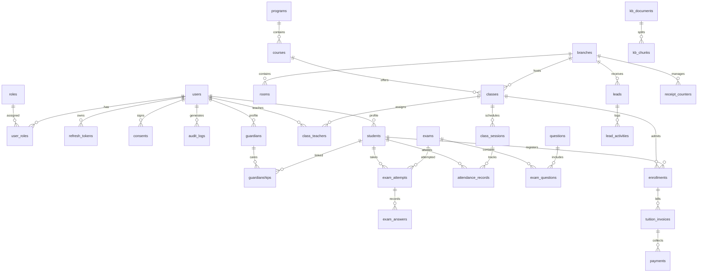

# MÔ HÌNH DỮ LIỆU & SƠ ĐỒ THỰC THỂ QUAN HỆ — CORELINK ACADEMY (DATA MODEL & ERD)

**Dự án**: CoreLink Academy  
**Cơ sở dữ liệu**: MySQL 8.4 LTS (84 Bảng, 11 Trigger, 4 View)  
**Phiên bản**: 2.0  
**Tác giả**: Database Architect & Solution Architect  

---

## 1. SƠ ĐỒ THỰC THỂ QUAN HỆ TỔNG THỂ (MERMAID ERD)

---

## 2. CHI TIẾT CÁC BẢNG DỮ LIỆU LÕI VÀ RÀNG BUỘC (CORE ENTITIES)

### 2.1. Nhóm Định danh & Bảo vệ Dữ liệu
- `users`: Mã tài khoản UUID, `email` (Unique), `phone` (Unique), `password_hash` (Argon2id), `status` (active, locked, pending_consent).
- `consents`: Lưu chữ ký đồng ý xử lý dữ liệu trẻ em theo Nghị định 13/2023/NĐ-CP (`scope = 'data_processing'`).
- `audit_logs`: Nhật ký kiểm toán mọi hành động nhạy cảm (`actor_id`, `action`, `entity_type`, `entity_id`, `before_state`, `after_state`).

### 2.2. Nhóm Đào tạo & Quan hệ Học thuật
- `students`: `id`, `user_id`, `student_code` (Unique), `dob`, `is_young_account`.
- `guardianships`: Khóa ngoại kép `student_id` và `guardian_id`. Giới hạn tối đa 4 phụ huynh/học sinh được bảo vệ bằng trigger cơ sở dữ liệu `trg_guardianships_limit`.
- `classes`: `id`, `program_id`, `name`, `max_capacity` (sĩ số tối đa), `start_date`, `end_date`, `status`.
- `class_sessions`: `id`, `class_id`, `teacher_id`, `room_id`, `start_time`, `end_time`, `status`.

### 2.3. Nhóm Điểm danh & Chuyên cần
- `teacher_checkins`: `id`, `session_id`, `teacher_id`, `latitude`, `longitude`, `photo_url`, `verified_at`.
- `attendance_records`: `id`, `session_id`, `student_id`, `status` (PRESENT, LATE, ABSENT, EXCUSED). Khóa duy nhất composite `UNIQUE(session_id, student_id)` ngăn chặn ghi trùng lặp.

### 2.4. Nhóm Tài chính & Học phí
- `tuition_invoices`: `id`, `enrollment_id`, `invoice_number` (Unique), `total_amount`, `paid_amount`, `status`.
- `payments`: `id`, `invoice_id`, `receipt_number` (Unique), `amount`, `payment_method`, `transaction_ref`.
- `receipt_counters`: `branch_id`, `fiscal_year`, `last_number`. Dùng cơ chế khóa dòng bi quan `SELECT ... FOR UPDATE` khi cấp phát số biên nhận mới.

---

## 3. DANH MỤC TRIGGER CƠ SỞ DỮ LIỆU BẢO VỆ TÍNH TOÀN VẸN (11 TRIGGERS)

1. `trg_guardianships_limit`: Ngăn chặn liên kết vượt quá 4 phụ huynh cho một học sinh.
2. `trg_messages_update_time`: Chặn sửa tin nhắn sau 5 phút kể từ thời điểm gửi.
3. `trg_messages_no_delete`: Chặn xóa cứng tin nhắn để bảo toàn nhật ký trao đổi.
4. `trg_payroll_lock`: Chặn sửa đổi các buổi học trong kỳ lương giáo viên đã được chốt.
5. `trg_consents_immutable`: Chặn sửa đổi bản ghi đồng ý dữ liệu đã ký của phụ huynh.
